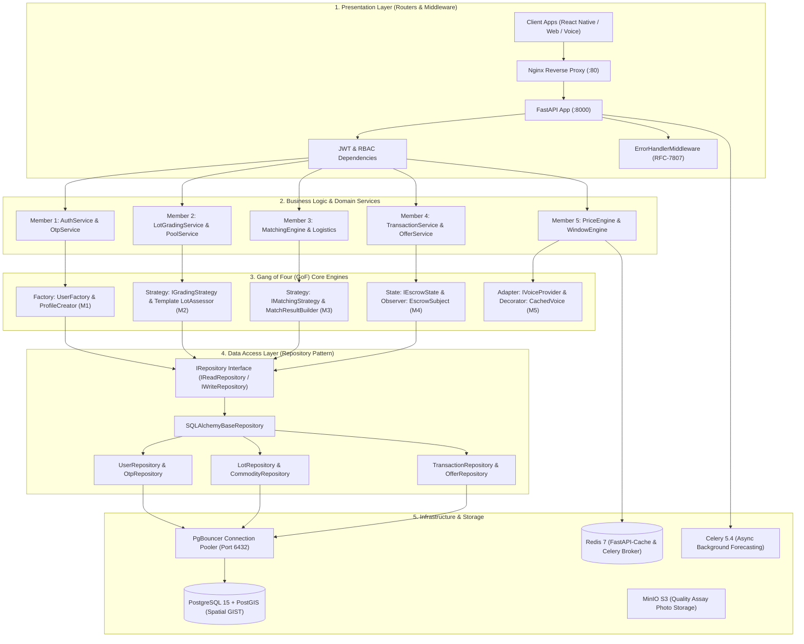
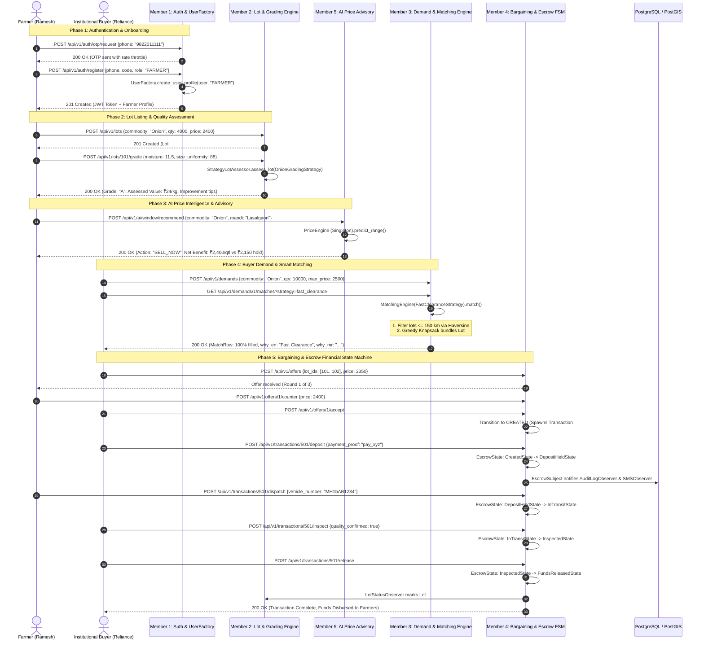
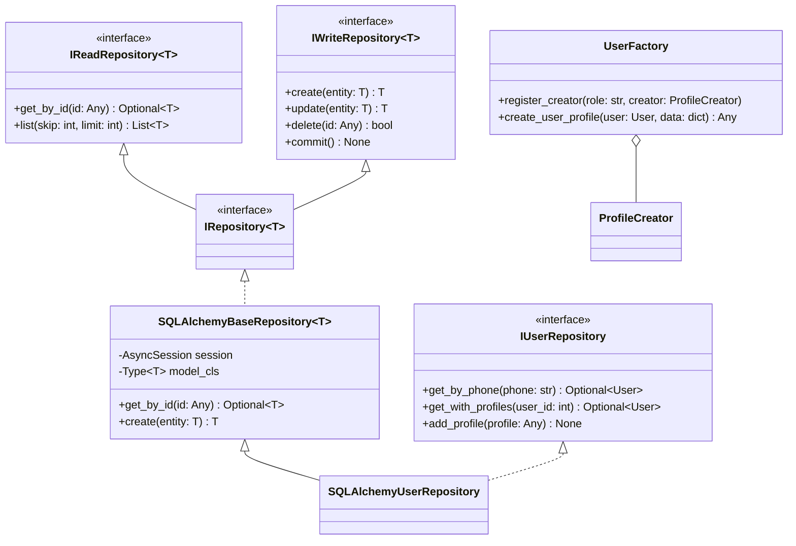
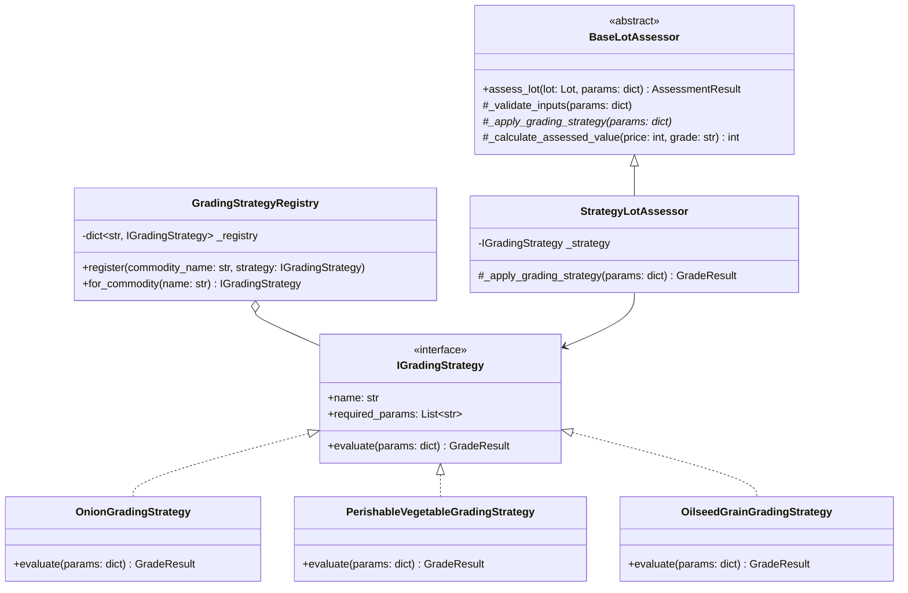
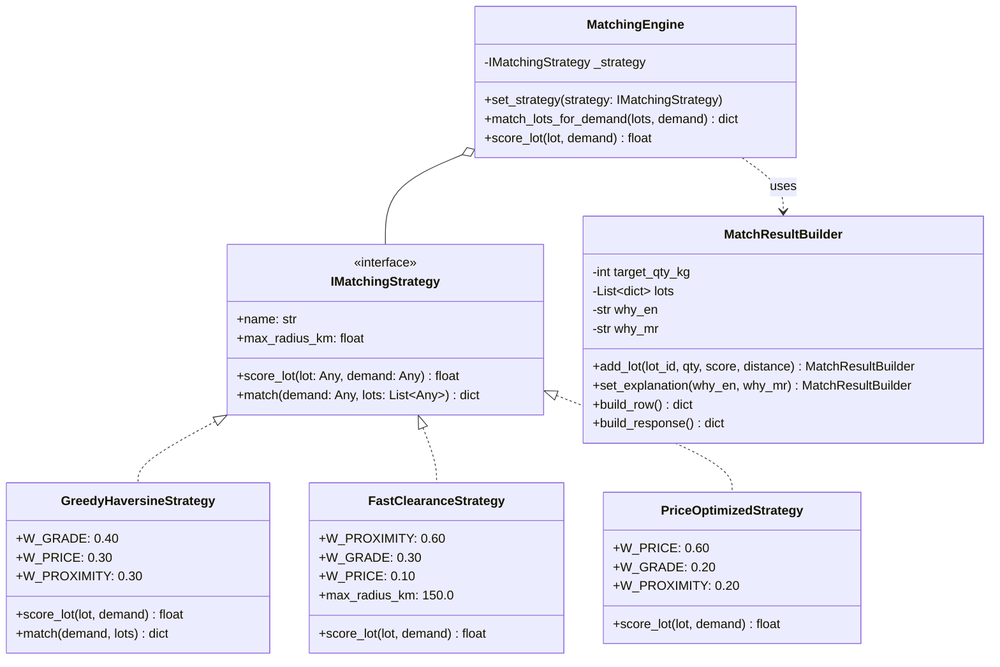
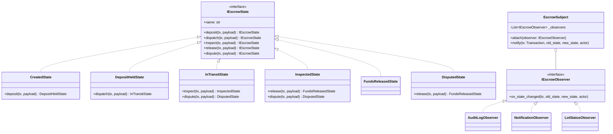
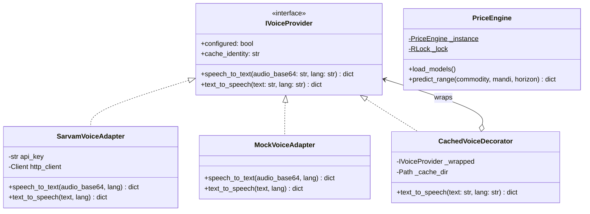
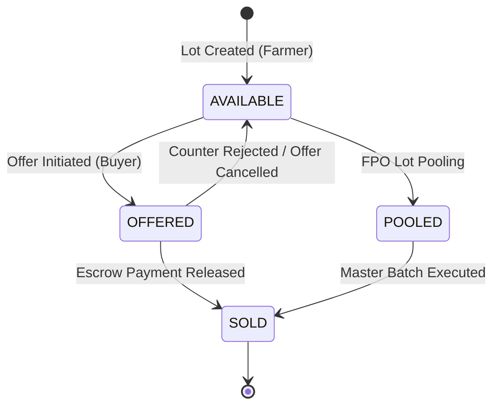
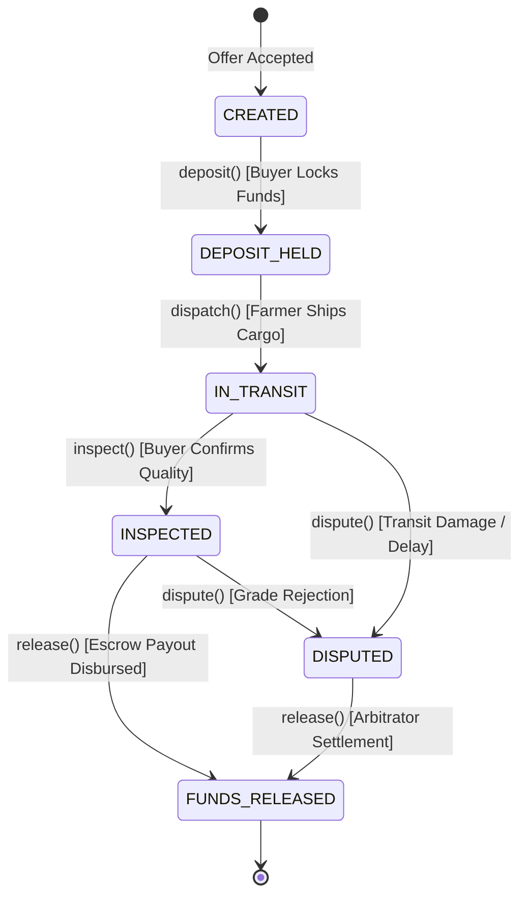

# Krishi-Mitr (Neolithic) — Master System Architecture & Low-Level Design (LLD)

> **Comprehensive Engineering Specification for Capstone Project Evaluation**  
> **Platform:** Krishi-Mitr (AgriSense / Neolithic-Backend)  
> **Architecture Style:** Clean Layered Architecture & Classic Gang of Four (GoF) Object-Oriented Design  
> **Scope:** Full Project Architecture + Complete LLD for All 5 Team Members

---

## Table of Contents
1. [Executive System Architecture & Tech Stack](#1-executive-system-architecture--tech-stack)
2. [End-to-End System Workflow & Sequence Diagram](#2-end-to-end-system-workflow--sequence-diagram)
3. [Member-by-Member Low-Level Design (LLD)](#3-member-by-member-low-level-design-lld)
   - [Member 1: Authentication, RBAC & Generic Repository](#member-1-nilesh--auth-roles--generic-repository-pattern)
   - [Member 2: Lot Lifecycle, Crop Grading & FPO Pooling](#member-2-pranay--lot-lifecycle-crop-grading--fpo-pooling)
   - [Member 3: Spatial Logistics, Greedy Knapsack & Swappable Matching](#member-3-akash--spatial-logistics-greedy-knapsack--strategy-pattern)
   - [Member 4: Bargaining Threads, Escrow State Machine & Observers](#member-4-karthik--bargaining-threads-escrow-fsm--observer-pattern)
   - [Member 5: AI Price Advisory, Voice Adapter & Cache Decorator](#member-5-nikhil--ai-price-advisory-voice-adapter--cache-decorator)
4. [Master Project UML Class Diagram](#4-master-project-uml-class-diagram)
5. [Master Project UML State Diagrams](#5-master-project-uml-state-diagrams)
6. [Complete SOLID Principles Defense Matrix](#6-complete-solid-principles-defense-matrix)
7. [Comprehensive API Endpoint Catalog](#7-comprehensive-api-endpoint-catalog)

---

## 1. Executive System Architecture & Tech Stack

### High-Level Architecture Overview
Krishi-Mitr is engineered using a **Layered Clean Architecture** that separates presentation (HTTP Controllers / FastAPI Routers), business logic (Domain Services & GoF Engines), data access abstractions (Generic Repository Layer), and external integrations (Adapters for Voice & Payment).

### Complete Technology Stack Matrix

| Layer | Technologies / Libraries | Rationale & Purpose |
| :--- | :--- | :--- |
| **API Framework** | Python 3.11, FastAPI, Uvicorn, Pydantic V2 | Async non-blocking I/O, automatic OpenAPI 3.0 docs, strict request validation. |
| **Database & GIS** | PostgreSQL 15, PostGIS 3.3, GeoAlchemy2, SQLAlchemy 2.0 (asyncio) | Relational integrity, spatial geospatial coordinate indexing (`ST_DWithin`, Point geometry). |
| **Connection Pooling** | PgBouncer | Manages up to 1,000 client connections over a lean pool of 20 PostgreSQL backends. |
| **Caching & Queue** | Redis 7, `fastapi-cache2`, Celery 5.4 | Sub-millisecond response caching for APMC Mandi rates; asynchronous worker task queues. |
| **Object Storage** | MinIO (Amazon S3 compatible) | Storage for lot quality inspection images and assay verification photographs. |
| **Machine Learning** | LightGBM, Pandas, Scikit-learn, Joblib | 14-day quantile price regression ($p10, p50, p90$) across 14 Maharashtra APMC commodities. |
| **Speech & Audio** | Sarvam AI API (Bulbul TTS, Saaras ASR) | Multilingual voice assistance in Marathi and Hindi with local disk-level caching. |
| **Testing Harness** | Pytest, Pytest-Asyncio, HTTPX | 140+ unit and integration tests executing in isolated in-memory fixtures. |

---

## 2. End-to-End System Workflow & Sequence Diagram

The following UML Sequence Diagram illustrates the complete procurement cycle across all 5 members' subsystems:

---

## 3. Member-by-Member Low-Level Design (LLD)

---

### Member 1 (Nilesh) — Auth, Roles & Generic Repository Pattern

#### 1. Scope & System Ownership
Member 1 is responsible for core user identification, role-based security, OTP verification policies, generic database decoupling, and Farmer Producer Organization (FPO) member administration.

#### 2. Design Patterns Implemented
1. **Generic Repository Pattern (`app/repositories/base.py`)**:
   - Decouples raw SQLAlchemy sessions from business services.
   - Adheres to the **Interface Segregation Principle (ISP)** by splitting the contract into `IReadRepository[T]` and `IWriteRepository[T]`, unified under `IRepository[T]`.
   - Concrete base: `SQLAlchemyBaseRepository[T]`.
2. **Factory Method Pattern (`app/domain/factories/user_factory.py`)**:
   - Encapsulates polymorphic profile creation for `Farmer` and `Buyer` entities without conditional branching inside registration routers.
   - Abstract creator `ProfileCreator` with concrete subclasses `FarmerProfileCreator` and `BuyerProfileCreator`.

#### 3. Security & Throttling Logic
- **Rate-Limiting Policy**: Implements an OTP issuance throttle strictly enforcing a maximum of **3 requests per 10-minute sliding window** (`OTP_MAX_REQUESTS_PER_WINDOW=3`, `OTP_THROTTLE_WINDOW_SECONDS=600`).
- **Brute-Force Guard**: Caps verification attempts at **5 invalid tries** before invalidating the token.
- **Expiry Window**: 120-second Time-To-Live (`OTP_TTL_SECONDS=120`).

#### 4. Class Structure (Member 1)

#### 5. Endpoints Owned by Member 1
- `POST /api/v1/auth/otp/request`: Issues rate-throttled verification code.
- `POST /api/v1/auth/otp/verify`: Validates code against attempt caps.
- `POST /api/v1/auth/register`: Spawns user and role profile via `UserFactory`.
- `GET /api/v1/auth/me`: Retrieves authenticated caller profile.
- `GET /api/v1/fpo/farmers`: Retrieves farmer directory for FPO administrator.

---

### Member 2 (Pranay) — Lot Lifecycle, Crop Grading & FPO Pooling

#### 1. Scope & System Ownership
Member 2 owns produce inventory registration, commodity-specific algorithmic quality assessment (Grading A/B/C), and FPO lot pooling (aggregating smallholder lots into unified commercial trade batches).

#### 2. Design Patterns Implemented
1. **Strategy Pattern for Grading (`app/engines/strategies/grading_strategy.py`)**:
   - `IGradingStrategy`: Abstract strategy contract defining `evaluate(params) -> GradeResult`.
   - `OnionGradingStrategy`: Evaluates diameter uniformity, moisture percentage, and neck tightness.
   - `PerishableVegetableGradingStrategy`: Evaluates physical damage, decay percentage, and discoloration.
   - `OilseedGrainGradingStrategy`: Evaluates moisture content, foreign matter percentage, and pest damage.
   - `GradingStrategyRegistry`: Central lookup registry dynamically resolving the grading strategy across all 14 Maharashtra crops.
2. **Template Method Pattern (`app/engines/lot_assessor.py`)**:
   - `BaseLotAssessor`: Skeleton algorithm defining invariant execution order:
     1. `_validate_inputs(params)`
     2. `_apply_grading_strategy(params)` (abstract hook delegated to strategy)
     3. `_calculate_assessed_value(base_price, grade)`
     4. `_generate_improvement_tips(params, grade)`
   - `StrategyLotAssessor`: Concrete assessor executing the template pipeline.

#### 3. Lot Lifecycle State Machine
Lot status transitions are strictly governed by `app/domain/lot_lifecycle.py`:
- `AVAILABLE` $\to$ `OFFERED` (or `LOCKED` when an offer is active)
- `OFFERED` $\to$ `AVAILABLE` (if offer rejected or cancelled)
- `OFFERED` $\to$ `SOLD` (when escrow payment is released)
- `AVAILABLE` $\to$ `POOLED` (when absorbed into an FPO batch)

#### 4. Class Structure (Member 2)

#### 5. Endpoints Owned by Member 2
- `POST /api/v1/lots`: Create single farmer lot.
- `GET /api/v1/lots` & `GET /api/v1/lots/{id}`: List and retrieve produce inventory.
- `POST /api/v1/lots/{id}/grade`: Execute algorithmic quality grading.
- `POST /api/v1/fpo/lots/pool`: Lock and combine individual lots into an FPO master batch.
- `POST /api/v1/pools/aggregate`: Aggregate district-level inventory metrics.

---

### Member 3 (Akash) — Spatial Logistics, Greedy Knapsack & Strategy Pattern

#### 1. Scope & System Ownership
Member 3 is responsible for demand matching algorithms, spatial Haversine distance pruning, multi-lot aggregation using greedy knapsack heuristics, and freight logistics cost/duration estimation.

#### 2. Design Patterns Implemented
1. **Gang of Four (GoF) Strategy Pattern (`app/engines/strategies/matching_strategy.py`)**:
   - `IMatchingStrategy`: Abstract strategy interface defining `score_lot(lot, demand) -> float` and `match(demand, candidate_lots) -> dict`.
   - `GreedyHaversineStrategy`: Balanced default (Grade 40%, Price 30%, Proximity 30%) with a **500 km spatial cutoff**.
   - `FastClearanceStrategy`: Perishable fast-clearance (Proximity 60%, Grade 30%, Price 10%) with a strict **150 km cutoff** to prevent transit spoilage.
   - `PriceOptimizedStrategy`: Budget-conscious matching (Price 60%, Grade 20%, Proximity 20%) with a **500 km radius**.
2. **Strategy Pattern Context (`app/engines/matching_engine.py`)**:
   - `MatchingEngine`: Holds an instance of `IMatchingStrategy`, providing runtime strategy swappability via `set_strategy()`.
3. **GoF Builder Pattern (`app/domain/builders/match_result_builder.py`)**:
   - `MatchResultBuilder`: Solves the telescoping constructor problem by incrementally assembling complex aggregated match DTOs (`MatchRow` and `MatchesRes`).
   - Computes weighted average distances, average scores, basis point fill rates (`fill_bps`), and attaches bilingual explainability (`why_en` and `why_mr`).

#### 3. Core Algorithms & Time Complexity
- **Haversine Distance Pruning**:
  $$\text{dist} = 2R \arcsin \left( \sqrt{\sin^2\left(\frac{\Delta \text{lat}}{2}\right) + \cos(\text{lat}_1)\cos(\text{lat}_2)\sin^2\left(\frac{\Delta \text{lng}}{2}\right)} \right)$$
  Prunes candidate lots exceeding the strategy radius threshold ($O(N)$).
- **Greedy Knapsack Aggregation ($O(N \log N)$)**:
  Scores all valid lots, sorts candidates descending by composite score ($O(N \log N)$), and greedily allocates lot capacities until the buyer's desired quantity is fulfilled.
- **Logistics Freight Estimator**:
  Computes freight cost in integer paise based on ₹15/km base rate plus volume scaling factor and 40 km/h average rural highway transit duration.

#### 4. Class Structure (Member 3)

#### 5. Endpoints Owned by Member 3
- `GET /api/v1/demands/{id}/matches?strategy={greedy|fast_clearance|price_optimized}`: Dynamically matches and bundles lots for buyer demand.
- `POST /api/v1/logistics/estimate`: Calculates Haversine transport distance, transit duration, and freight cost in paise.

---

### Member 4 (Karthik) — Bargaining Threads, Escrow FSM & Observer Pattern

#### 1. Scope & System Ownership
Member 4 governs bilateral bargaining negotiations (offer threads and counter-offers), the milestone-based Escrow Financial State Machine, immutable audit event logging, and dispute resolution.

#### 2. Design Patterns Implemented
1. **GoF State Pattern (`app/domain/states/escrow_state.py`)**:
   - `IEscrowState`: Polymorphic state interface defining valid operational transitions: `deposit()`, `dispatch()`, `inspect()`, `release()`, and `dispute()`.
   - Concrete states: `CreatedState`, `DepositHeldState`, `InTransitState`, `InspectedState`, `FundsReleasedState`, and `DisputedState`.
   - Out-of-order operations raise `HTTP 409 Conflict (INVALID_TRANSITION)`.
2. **GoF Observer Pattern (`app/events/escrow_observer.py`)**:
   - `EscrowSubject`: Manages observer lifecycle (`attach`, `detach`, `notify`).
   - `IEscrowObserver`: Interface for state change listeners.
   - `AuditLogObserver`: Appends immutable audit records into the `escrow_events` database table.
   - `NotificationObserver`: Dispatches asynchronous push/SMS alerts to buyers and farmers.
   - `LotStatusObserver`: Updates inventory status to `SOLD` upon terminal escrow payout.

#### 3. Bilateral Bargaining Protocol
- Buyers and farmers submit counter-offers in a threaded negotiation structure.
- **Round-Cap Policy**: Negotiations are strictly limited to a **maximum of 3 counter-offer rounds** before locking to prevent infinite bargaining loops.
- Acceptance of an offer automatically spawns an Escrow `Transaction` initialized in the `CREATED` state.

#### 4. Class Structure (Member 4)

#### 5. Endpoints Owned by Member 4
- `POST /api/v1/offers`: Initiate buyer offer.
- `POST /api/v1/offers/{id}/counter`: Submit counter-offer (capped at 3 rounds).
- `POST /api/v1/offers/{id}/accept`: Accept offer and instantiate escrow transaction.
- `POST /api/v1/transactions/{id}/deposit`: Lock buyer deposit (`DEPOSIT_HELD`).
- `POST /api/v1/transactions/{id}/dispatch`: Record transit vehicle dispatch (`IN_TRANSIT`).
- `POST /api/v1/transactions/{id}/inspect`: Record quality inspection confirmation (`INSPECTED`).
- `POST /api/v1/transactions/{id}/release`: Release escrow funds to farmers (`FUNDS_RELEASED`).
- `POST /api/v1/disputes`: File quality/transit dispute pausing escrow (`DISPUTED`).

---

### Member 5 (Nikhil) — AI Advisory, Voice Adapter & Cache Decorator

#### 1. Scope & System Ownership
Member 5 manages ML-based price forecasting models, the Sell-Now vs. Hold-in-Warehouse decision engine, multilingual speech integration (Sarvam AI), and audio disk caching.

#### 2. Design Patterns Implemented
1. **GoF Adapter Pattern (`app/adapters/voice_adapter.py`)**:
   - `IVoiceProvider`: Abstract interface for speech services (`speech_to_text`, `text_to_speech`).
   - `SarvamVoiceAdapter`: Concrete adapter wrapping the external Sarvam REST API (Saaras ASR & Bulbul TTS).
   - `MockVoiceAdapter`: Standalone test double returning deterministic synthetic audio payloads for offline testing.
2. **GoF Decorator Pattern (`app/adapters/voice_adapter.py`)**:
   - `CachedVoiceDecorator`: Wraps any `IVoiceProvider` instance.
   - Hashes provider identity, target language, and text to generate cache keys.
   - Implements **thread-safe atomic disk writes** using private temporary files to prevent partial corrupt JSON/WAV generation during concurrent calls.
3. **GoF Singleton Pattern (`app/engines/price_engine.py`)**:
   - `PriceEngine`: Maintains the trained LightGBM quantile regression models in memory.
   - Uses a re-entrant lock (`threading.RLock`) to ensure single-instance instantiation across multiple concurrent worker threads.

#### 3. AI Advisory & Window Recommendation Engine
- **Quantile Forecasting**: Generates 14-day interval price predictions guaranteeing monotonicity:
  $$p10 \le p50 \le p90$$
- **Sale Window Engine (`app/engines/window_engine.py`)**:
  Calculates net farmer proceeds by comparing immediate spot mandi liquidation against holding crops in WDRA-accredited cold storage (subtracting warehouse rent, financing interest, and estimated commodity spoilage rates).

#### 4. Class Structure (Member 5)

#### 5. Endpoints Owned by Member 5
- `GET /api/v1/ai/forecast`: Returns 14-day $p10, p50, p90$ price forecasts.
- `POST /api/v1/ai/window/recommend`: Evaluates Sell-Now vs. Hold financial decision.
- `POST /api/v1/voice/transcribe`: Converts farmer speech into intent text (ASR).
- `POST /api/v1/voice/narrate`: Synthesizes Marathi/Hindi audio from advisory text (TTS).

---

## 4. Master Project UML Class Diagram

The following unified class diagram depicts the inheritance, interfaces, and cross-cutting relationships across the entire platform:

```mermaid
classDiagram
    %% Member 1: User & Repository Layer
    class User {
        +int id
        +str phone
        +UserRole role
        +datetime created_at
    }
    class Farmer {
        +int user_id
        +str district
        +Point location
    }
    class Buyer {
        +int user_id
        +str company_name
        +str gst_number
    }
    User <|-- Farmer
    User <|-- Buyer

    class IRepository~T~ {
        <<interface>>
        +get_by_id(id) T
        +create(entity) T
    }
    class UserFactory {
        +create_user_profile(user, data)
    }

    %% Member 2: Lot & Grading
    class Lot {
        +int id
        +int farmer_id
        +str commodity
        +int quantity_kg
        +int expected_price_paise
        +str quality_grade
        +LotStatus status
    }
    class IGradingStrategy {
        <<interface>>
        +evaluate(params) GradeResult
    }
    class StrategyLotAssessor {
        +assess_lot(lot, params) AssessmentResult
    }
    StrategyLotAssessor --> IGradingStrategy
    Farmer "1" *-- "many" Lot

    %% Member 3: Demand & Matching
    class BuyerDemand {
        +int id
        +int buyer_id
        +str commodity
        +int target_qty_kg
        +int max_price_paise
    }
    class IMatchingStrategy {
        <<interface>>
        +score_lot(lot, demand) float
        +match(demand, lots) dict
    }
    class MatchingEngine {
        +set_strategy(strategy: IMatchingStrategy)
        +match_lots_for_demand(lots, demand) dict
    }
    class MatchResultBuilder {
        +add_lot(id, qty, score, dist)
        +build_response() dict
    }
    MatchingEngine o-- IMatchingStrategy
    MatchingEngine ..> MatchResultBuilder
    Buyer "1" *-- "many" BuyerDemand

    %% Member 4: Offers & Escrow FSM
    class Offer {
        +int id
        +int demand_id
        +int round_num
        +OfferStatus status
    }
    class Transaction {
        +int id
        +int offer_id
        +int amount_paise
        +EscrowState status
    }
    class IEscrowState {
        <<interface>>
        +deposit()
        +dispatch()
        +inspect()
        +release()
    }
    class EscrowSubject {
        +notify(tx, old_state, new_state)
    }
    Transaction o-- IEscrowState
    Transaction --> EscrowSubject

    %% Member 5: AI & Voice
    class PriceEngine {
        <<singleton>>
        +predict_range() dict
    }
    class IVoiceProvider {
        <<interface>>
        +speech_to_text()
        +text_to_speech()
    }
    class CachedVoiceDecorator {
        -IVoiceProvider _wrapped
    }
    CachedVoiceDecorator o-- IVoiceProvider
```

---

## 5. Master Project UML State Diagrams

### 1. Lot Inventory Lifecycle (Member 2)

### 2. Escrow Financial State Machine (Member 4)

---

## 6. Complete SOLID Principles Defense Matrix

| Principle | Architectural Application in Krishi-Mitr | Exact File Reference |
| :--- | :--- | :--- |
| **S - Single Responsibility Principle** | - `AuditLogObserver` is solely responsible for appending immutable history. - `OtpService` only manages verification token lifetimes and brute-force attempt caps. - `MatchResultBuilder` only manages DTO formatting and string explanations. | [`app/events/escrow_observer.py`](file:///Users/akashg/Desktop/Project/Agriculture/Neolithic/app/events/escrow_observer.py) [`app/services/auth_service.py`](file:///Users/akashg/Desktop/Project/Agriculture/Neolithic/app/services/auth_service.py) [`app/domain/builders/match_result_builder.py`](file:///Users/akashg/Desktop/Project/Agriculture/Neolithic/app/domain/builders/match_result_builder.py) |
| **O - Open/Closed Principle** | - New matching strategies (e.g. `ExportGradeStrategy`) can be added without modifying `MatchingEngine`. - New crop grading strategies register dynamically in `GradingStrategyRegistry` without altering existing commodity code. - New user roles are registered in `UserFactory`. | [`app/engines/matching_engine.py`](file:///Users/akashg/Desktop/Project/Agriculture/Neolithic/app/engines/matching_engine.py) [`app/engines/strategies/grading_strategy.py`](file:///Users/akashg/Desktop/Project/Agriculture/Neolithic/app/engines/strategies/grading_strategy.py) [`app/domain/factories/user_factory.py`](file:///Users/akashg/Desktop/Project/Agriculture/Neolithic/app/domain/factories/user_factory.py) |
| **L - Liskov Substitution Principle** | - Any `IEscrowState` subclass can be assigned to `Transaction` without breaking client callers. - `MockVoiceAdapter` substitutes `SarvamVoiceAdapter` transparently in automated test fixtures without conditional checks. | [`app/domain/states/escrow_state.py`](file:///Users/akashg/Desktop/Project/Agriculture/Neolithic/app/domain/states/escrow_state.py) [`app/adapters/voice_adapter.py`](file:///Users/akashg/Desktop/Project/Agriculture/Neolithic/app/adapters/voice_adapter.py) |
| **I - Interface Segregation Principle** | - `IRepository[T]` is split into fine-grained `IReadRepository[T]` and `IWriteRepository[T]` interfaces so read-only services aren't forced to depend on mutation methods. | [`app/repositories/base.py`](file:///Users/akashg/Desktop/Project/Agriculture/Neolithic/app/repositories/base.py) |
| **D - Dependency Inversion Principle** | - Routers and services depend on abstract abstractions (`IUserRepository`, `ILotRepository`, `IMatchingStrategy`, `IVoiceProvider`) injected via FastAPI `Depends()`, completely decoupling business logic from underlying database drivers. | [`app/dependencies/repositories.py`](file:///Users/akashg/Desktop/Project/Agriculture/Neolithic/app/dependencies/repositories.py) [`app/dependencies/voice.py`](file:///Users/akashg/Desktop/Project/Agriculture/Neolithic/app/dependencies/voice.py) |

---

## 7. Comprehensive API Endpoint Catalog

| Member | HTTP Method | Endpoint Route | Request Schema | Response Schema | Description |
| :---: | :---: | :--- | :--- | :--- | :--- |
| **M1** | `POST` | `/api/v1/auth/otp/request` | `OtpRequest` | `OtpRequestRes` | Requests phone verification token with 3-req/10-min rate throttle. |
| **M1** | `POST` | `/api/v1/auth/otp/verify` | `OtpVerify` | `AuthResponse` | Verifies OTP code against attempt caps. |
| **M1** | `POST` | `/api/v1/auth/register` | `RegisterRequest` | `AuthResponse` | Registers user and instantiates role profile via `UserFactory`. |
| **M1** | `GET` | `/api/v1/auth/me` | *None* | `UserDetailResponse` | Returns authenticated user details and role profiles. |
| **M1** | `GET` | `/api/v1/fpo/farmers` | *None* | `List[FarmerOut]` | Retrieves farmer roster registered under caller's FPO. |
| **M2** | `POST` | `/api/v1/lots` | `LotCreate` | `LotOut` | Creates new harvest lot. |
| **M2** | `POST` | `/api/v1/lots/{id}/grade` | `GradeRequest` | `GradeResultOut` | Executes commodity-specific algorithmic quality assay. |
| **M2** | `POST` | `/api/v1/fpo/lots/pool` | `PoolRequest` | `BatchLotOut` | Bundles smallholder lots into an aggregated FPO master lot. |
| **M3** | `GET` | `/api/v1/demands/{id}/matches` | *None* (`?strategy=`) | `MatchesRes` | Computes greedy knapsack lot matches with bilingual explainability. |
| **M3** | `POST` | `/api/v1/logistics/estimate` | `LogisticsEstimateIn` | `LogisticsEstimateOut` | Computes Haversine transit distance, freight costs, and transit duration. |
| **M4** | `POST` | `/api/v1/offers` | `OfferCreate` | `OfferDto` | Initiates bilateral offer on candidate produce lots. |
| **M4** | `POST` | `/api/v1/offers/{id}/counter` | `CounterOfferIn` | `OfferDto` | Submits counter-offer (capped at 3 rounds). |
| **M4** | `POST` | `/api/v1/offers/{id}/accept` | *None* | `TransactionOut` | Accepts negotiation and instantiates Escrow State Machine. |
| **M4** | `POST` | `/api/v1/transactions/{id}/deposit` | `DepositProofIn` | `TransactionOut` | Buyer deposits payment into escrow (`DEPOSIT_HELD`). |
| **M4** | `POST` | `/api/v1/transactions/{id}/dispatch` | `DispatchIn` | `TransactionOut` | Farmer registers transit cargo dispatch (`IN_TRANSIT`). |
| **M4** | `POST` | `/api/v1/transactions/{id}/inspect` | `InspectIn` | `TransactionOut` | Buyer signs off on quality inspection (`INSPECTED`). |
| **M4** | `POST` | `/api/v1/transactions/{id}/release` | *None* | `TransactionOut` | Terminal release of escrow funds to farmer (`FUNDS_RELEASED`). |
| **M4** | `POST` | `/api/v1/disputes` | `DisputeCreate` | `DisputeOut` | Halts escrow payout and transitions to `DISPUTED` for arbitration. |
| **M5** | `GET` | `/api/v1/ai/forecast` | *None* (`?commodity=&mandi=`) | `ForecastOut` | Generates 14-day $p10, p50, p90$ price quantile predictions. |
| **M5** | `POST` | `/api/v1/ai/window/recommend` | `WindowReq` | `WindowRes` | Calculates net benefit comparing immediate sale vs warehouse holding. |
| **M5** | `POST` | `/api/v1/voice/transcribe` | `TranscribeIn` | `TranscribeOut` | Converts farmer spoken audio into intent text using Sarvam ASR. |
| **M5** | `POST` | `/api/v1/voice/narrate` | `NarrateIn` | `NarrateOut` | Synthesizes advisory speech audio with atomic local disk caching. |

---
*Document compiled and verified against the Krishi-Mitr (Neolithic-Backend) production implementation.*

