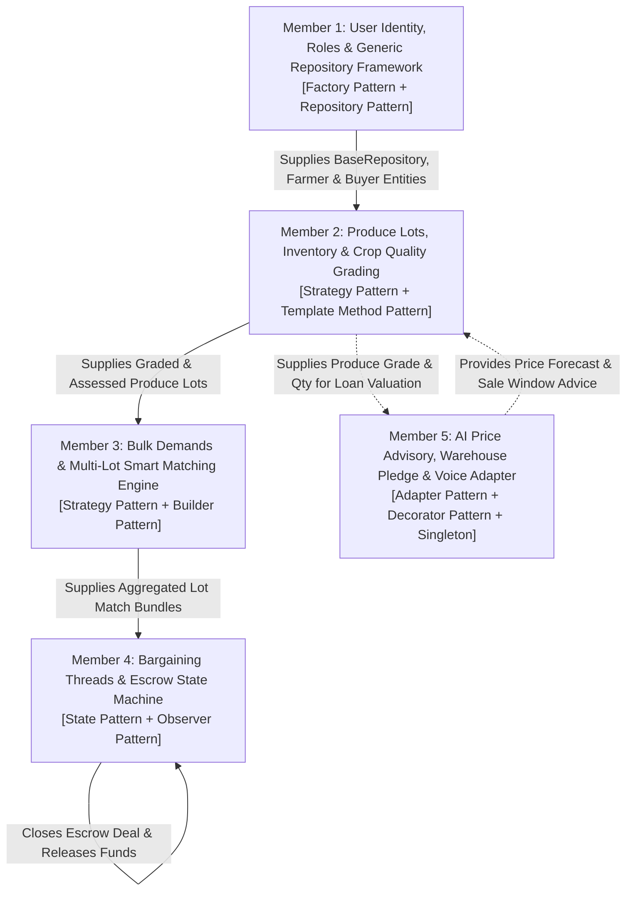

# Krishi-Mitr (Neolithic) — 5-Member LLD Implementation Master Plan

> **Final-Year Capstone System Design & Low-Level Design (LLD)**  
> **Evaluation Date:** First Week of November  
> **Execution Strategy:** Sequential Feature Pipeline (Strictly LLD, Design Patterns & Working Code)

---

## 1. Executive Strategy: Equal LLD Distribution

Every single member is assigned **full-stack LLD responsibility** for a distinct domain module:
- **Their own set of Database Models** (from the 25 existing models).
- **Their own REST APIs** (with Pydantic schemas, validation, and HTTP responses).
- **Their own Gang of Four (GoF) Design Patterns** (with formal interfaces, abstract classes, and polymorphism).
- **Direct SOLID Principles application** in their code.
- **Working Automated Tests (pytest)** validating real response codes and edge cases.
- **Their own dedicated Markdown file** explaining their design, code, and viva defense points.

---

## 2. Sequential Execution Flow & Dependency Graph

The work is arranged in a strict sequential pipeline so that no member is blocked, and each member builds directly upon the interface contracts established by the previous member:



### Step-by-Step Flow:
1. **Step 1 (Member 1 executes first)**: Builds the generic database abstraction (`IRepository[T]` and `SQLAlchemyBaseRepository[T]`) and the User Authentication & Role system using the **Factory Pattern**. Outputs clean `Farmer` and `Buyer` entities with JWT auth dependencies.
2. **Step 2 (Member 2 executes second)**: Inherits Member 1's `BaseRepository` and `Farmer` entity. Builds the Produce Lot listing and Quality Grading Engine using the **Strategy Pattern** and **Template Method Pattern**. Outputs active produce lots with assessed quality grades (A, B, C).
3. **Step 3 (Member 3 executes third)**: Uses Member 1's `Buyer` entity and Member 2's `Lot` pool. Builds the Buyer Demand procurement engine and the Greedy Multi-Lot Matching Engine using the **Strategy Pattern** and **Builder Pattern** (with Haversine distance calculations). Outputs bundled lot matches.
4. **Step 4 (Member 4 executes fourth)**: Takes Member 3's matched lot bundles and Member 1's buyer/farmer profiles. Builds the Threaded Bargaining system and the Escrow Payment Lifecycle using the **State Pattern** and **Observer Pattern**. Enforces valid transitions and rejects invalid state jumps with `409 INVALID_TRANSITION`.
5. **Step 5 (Member 5 executes fifth)**: Connects AI forecasting and voice accessibility. Builds the 14-day Quantile Price Forecasting window, Warehouse Pledge Loan Quoting engine, and the Trilingual Voice Assistant using the **Adapter Pattern**, **Decorator Pattern**, and **Singleton Pattern**.

---

## 3. Master Allocation Matrix: Models, APIs, Patterns & SOLID

| Member | Domain Module | Assigned DB Models (Tables) | Assigned REST APIs | Assigned GoF Design Patterns | Key SOLID Principles |
| :--- | :--- | :--- | :--- | :--- | :--- |
| **Member 1** | **User Identity, Roles & Base Data Access** | 1. `User`<br>2. `Farmer`<br>3. `Buyer`<br>4. `OtpCode`<br>5. `FPO` | `POST /auth/otp/request`<br>`POST /auth/otp/verify`<br>`POST /auth/register`<br>`GET /auth/me`<br>`GET /fpo/farmers` | • **Factory Method Pattern** (`UserFactory`)<br>• **Repository Pattern** (`IRepository[T]`) | **DIP**: Services depend on abstract repositories.<br>**LSP**: `Farmer`/`Buyer` substitute `User`.<br>**ISP**: `IReadRepository` vs `IWriteRepository`. |
| **Member 2** | **Produce Lots & Quality Grading** | 6. `Lot`<br>7. `BatchLotMember`<br>8. `Commodity`<br>9. `District` | `POST /lots`<br>`GET /lots`<br>`GET /lots/{id}`<br>`POST /lots/{id}/grade`<br>`POST /fpo/lots/pool` | • **Strategy Pattern** (`IGradingStrategy`)<br>• **Template Method Pattern** (`BaseLotAssessor`) | **SRP**: Grading engine decoupled from Lot entity.<br>**OCP**: New crop grading rules added without modifying service. |
| **Member 3** | **Demand Aggregation & Smart Matching** | 10. `BuyerDemand`<br>11. `MandiLocation`<br>12. `Warehouse`<br>13. `LogisticsCostRoute` | `POST /demands`<br>`GET /demands`<br>`GET /demands/{id}/matches`<br>`GET /ref/mandis`<br>`POST /logistics/estimate` | • **Strategy Pattern** (`IMatchingStrategy`)<br>• **Builder Pattern** (`MatchResultBuilder`) | **SRP**: Matching algorithm separated from HTTP handling.<br>**OCP**: New routing heuristics added via new strategy. |
| **Member 4** | **Bargaining Threads & Escrow FSM** | 14. `Offer`<br>15. `OfferLot`<br>16. `Transaction`<br>17. `EscrowEvent`<br>18. `Dispute` | `POST /offers`<br>`POST /offers/{id}/counter`<br>`POST /offers/{id}/accept`<br>`POST /transactions/{id}/deposit`<br>`POST /transactions/{id}/release`<br>`POST /disputes` | • **State Pattern** (`IEscrowState`)<br>• **Observer Pattern** (`EscrowSubject`) | **LSP**: Any state cleanly substitutes `IEscrowState`.<br>**OCP**: Adding states without touching existing state classes.<br>**SRP**: Audit logger isolated from escrow transition. |
| **Member 5** | **AI Market Advisory & Voice Assistant** | 19. `PriceForecast`<br>20. `PriceObservation`<br>21. `ModelRun`<br>22. `PledgeQuoteRecord`<br>23. `CallSession`<br>24. `VoiceInteraction`<br>25. `LogisticsProvider` | `GET /ai/forecast`<br>`POST /ai/window/recommend`<br>`POST /voice/transcribe`<br>`POST /voice/narrate`<br>`GET /logistics/nearby` | • **Adapter Pattern** (`IVoiceProvider`)<br>• **Decorator Pattern** (`CachedVoiceDecorator`)<br>• **Singleton Pattern** (`PriceEngine`) | **DIP**: High-level routers depend on `IVoiceProvider`.<br>**SRP**: Audio transport decoupled from pricing engine.<br>**OCP**: Easily swap voice AI vendors via new adapters. |

---

## 4. Verification & Testing Matrix

Every member's module must have direct automated test coverage in `tests/` verifying real API responses, HTTP codes, and edge-case exceptions:

```
tests/
├── test_member_1_auth_repo.py      # Factory, OTP expiry, Repo CRUD, Polymorphic User roles
├── test_member_2_lots_grading.py    # Grading Strategy A/B/C, Assessed value, Lot pooling
├── test_member_3_matching.py        # Haversine distance limit, Multi-lot greedy bundle, Builder
├── test_member_4_escrow_fsm.py      # State transitions, 409 INVALID_TRANSITION, Observer events
└── test_member_5_ai_voice.py        # Quantile non-crossing, Audio cache hit/miss, Adapter fallback
```

---

## 5. Member-Specific Documentation Directory

Each member has a dedicated, comprehensive markdown document that covers their exact codebase files, design patterns, UML class design, code snippets, test cases, and oral defense script:

1. [LLD_MEMBER_1_AUTH_AND_REPOSITORY.md](file:///Users/akashg/Desktop/Agriculture/Neolithic/LLD_MEMBER_1_AUTH_AND_REPOSITORY.md)
2. [LLD_MEMBER_2_LOTS_AND_GRADING.md](file:///Users/akashg/Desktop/Agriculture/Neolithic/LLD_MEMBER_2_LOTS_AND_GRADING.md)
3. [LLD_MEMBER_3_DEMANDS_AND_MATCHING.md](file:///Users/akashg/Desktop/Agriculture/Neolithic/LLD_MEMBER_3_DEMANDS_AND_MATCHING.md)
4. [LLD_MEMBER_4_OFFERS_AND_ESCROW_FSM.md](file:///Users/akashg/Desktop/Agriculture/Neolithic/LLD_MEMBER_4_OFFERS_AND_ESCROW_FSM.md)
5. [LLD_MEMBER_5_AI_ADVISORY_AND_VOICE.md](file:///Users/akashg/Desktop/Agriculture/Neolithic/LLD_MEMBER_5_AI_ADVISORY_AND_VOICE.md)

