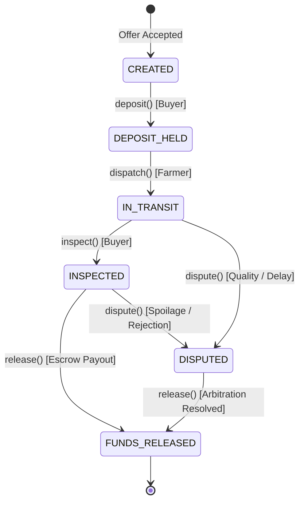

# Karthik — Implementation Report: Offers, Bargaining & Escrow FSM

> **Author / Student:** Karthik  
> **Module:** Offers, Bargaining Threads & Escrow State Machine  
> **Branch:** `refactor/offers-escrow-fsm`  
> **Execution Priority:** Step 4 — Bargaining Threads, Escrow State Machine & Immutable Audit Events  

---

## 1. Summary of Completed Implementation

| LLD Item | Status | Location |
|---|---|---|
| **GoF State Pattern (`IEscrowState`)** | ✅ Done | `app/domain/states/escrow_state.py`, `app/domain/states/__init__.py` |
| Concrete State Classes (`CreatedState`, `DepositHeldState`, `InTransitState`, `InspectedState`, `FundsReleasedState`, `DisputedState`) | ✅ Done (Enforces mathematical state transitions, 409 Conflict on invalid operations) | `app/domain/states/escrow_state.py` |
| **GoF Observer Pattern (`EscrowSubject`, `IEscrowObserver`)** | ✅ Done | `app/events/escrow_observer.py`, `app/events/__init__.py` |
| Concrete Observers (`AuditLogObserver`, `NotificationObserver`, `LotStatusObserver`) | ✅ Done (Decouples audit logging and event dispatch from transaction state logic) | `app/events/escrow_observer.py` |
| 5 Database Models (`Offer`, `OfferLot`, `Transaction`, `EscrowEvent`, `Dispute`) | ✅ Completed & Enhanced (Added polymorphic synonyms & relationship bindings) | `app/models/offer.py`, `app/models/transaction.py`, `app/models/dispute.py` |
| Generic Repositories (`IOfferRepository`, `ITransactionRepository`, `IEscrowEventRepository`, `IDisputeRepository`) | ✅ Done (Built on generic `SQLAlchemyBaseRepository[T]`) | `app/repositories/offer_repository.py`, `app/repositories/transaction_repository.py` |
| FastAPI Dependency Providers (`get_transaction_service`, `get_offer_service`, `get_dispute_service`) | ✅ Done (DIP compliance) | `app/dependencies/escrow.py`, `app/dependencies/repositories.py` |
| Bargaining Thread & Counter-Offer Engine | ✅ Done (Max 3 rounds capped with 409 `MAX_ROUNDS` exception, oldest-first thread audit) | `app/services/offer_service.py`, `app/routers/offers.py` |
| Escrow Order Lifecycle & Transition APIs | ✅ Done (`/deposit`, `/dispatch`, `/inspect`, `/release`, `/transition`, `/events`) | `app/services/transaction_service.py`, `app/routers/transactions.py` |
| Conflict Arbitration Claim APIs | ✅ Done (Transitions escrow to `DISPUTED`, registers dispute, supports review/resolution) | `app/services/dispute_service.py`, `app/routers/disputes.py` |
| Automated Pytest Test Suite | ✅ 15 tests, 100% passing (All 129 tests passing across all project suites) | `tests/test_offers_escrow_fsm.py` |

---

## 2. Design Patterns Implemented

### Pattern 1: GoF State Pattern (Behavioral)
Encapsulates state-specific behavior for financial transactions. Out-of-order transitions are mathematically rejected at runtime with `HTTP 409 Conflict`.

### Pattern 2: GoF Observer Pattern (Behavioral)
When any transaction transition occurs, `EscrowSubject` notifies all attached observers asynchronously without polluting business transaction logic:
1. `AuditLogObserver`: Writes immutable event record into `escrow_events`.
2. `NotificationObserver`: Dispatches simulated SMS/push notification payloads to counterparty.
3. `LotStatusObserver`: Reacts to terminal escrow release to update produce lot inventory.

---

## 3. SOLID Principles Proof Matrix

1. **Single Responsibility Principle (SRP)**:
   - `CreatedState` only governs transitions permitted when an order is created.
   - `AuditLogObserver` is solely responsible for recording immutable history to `escrow_events`.
   - `TransactionService` coordinates workflow orchestration without hardcoded database driver calls.
2. **Open/Closed Principle (OCP)**:
   - Adding new milestones (e.g. `PartialRefundState` or `ArbitrationMediationState`) requires subclassing `IEscrowState` without changing existing state classes.
   - Adding new notifications requires attaching a new `IEscrowObserver` without modifying `EscrowSubject`.
3. **Liskov Substitution Principle (LSP)**:
   - Any subclass of `IEscrowState` substitutes cleanly in `TransactionService` without breaking calling code.
4. **Interface Segregation Principle (ISP)**:
   - Dedicated interfaces (`IOfferRepository`, `ITransactionRepository`, `IEscrowEventRepository`, `IDisputeRepository`) provide tailored contracts rather than bloated monolithic interfaces.
5. **Dependency Inversion Principle (DIP)**:
   - Routers depend on `OfferService`, `TransactionService`, `DisputeService` via FastAPI `Depends()`.
   - Services depend on repository interfaces (`IOfferRepository`, `ITransactionRepository`), enabling in-memory testing without a live database.

---

## 4. API Endpoints & Contracts

| Method | Endpoint | Request Payload | Response Schema | Description |
|---|---|---|---|---|
| `POST` | `/api/v1/offers` | `{"lot_ids": [10, 20], "offered_price_paise": 230000, "qty_kg": 1000}` | `OfferDto` | Buyer initiates offer |
| `POST` | `/api/v1/offers/{id}/counter` | `{"counter_price_paise": 235000}` | `OfferDto` | Counter-offer (capped at 3 rounds) |
| `POST` | `/api/v1/offers/{id}/accept` | *Empty* | `TransactionOut` | Spawns Escrow Transaction in `CREATED` state |
| `POST` | `/api/v1/offers/{id}/reject` | *Empty* | `OfferDto` | Rejects negotiation |
| `GET` | `/api/v1/offers/{id}/thread` | *None* | `List[OfferDto]` | Oldest-first negotiation history |
| `POST` | `/api/v1/transactions/{id}/deposit` | `{"payment_proof": "pay_xyz"}` | `TransactionOut` | Buyer deposits funds (`DEPOSIT_HELD`) |
| `POST` | `/api/v1/transactions/{id}/dispatch` | `{"vehicle_number": "MH15AB1234"}` | `TransactionOut` | Farmer dispatches cargo (`IN_TRANSIT`) |
| `POST` | `/api/v1/transactions/{id}/inspect` | `{"quality_confirmed": true}` | `TransactionOut` | Buyer verifies quality (`INSPECTED`) |
| `POST` | `/api/v1/transactions/{id}/release` | *Empty* | `TransactionOut` | Releases escrow funds (`FUNDS_RELEASED`) |
| `POST` | `/api/v1/transactions/{id}/transition` | `{"action": "DEPOSIT_PAID"}` | `TransactionOut` | Polymorphic state machine step |
| `GET` | `/api/v1/transactions/{id}/events` | *None* | `List[EscrowEventOut]` | Append-only escrow event timeline |
| `POST` | `/api/v1/disputes` | `{"transaction_id": 1, "reason": "decay"}` | `DisputeOut` | Halts release; moves to `DISPUTED` |
| `GET` | `/api/v1/disputes` | *None* | `List[DisputeOut]` | Lists user disputes |
| `PATCH` | `/api/v1/disputes/{id}` | `{"status": "investigating"}` | `DisputeOut` | Updates dispute status |

---

## 5. Verification & Test Suite

All 15 tests in `tests/test_offers_escrow_fsm.py` pass cleanly in ~0.08s. All 129 tests across the entire repository pass with zero errors.
