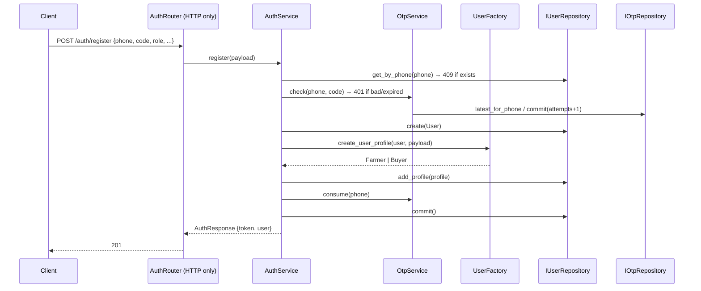
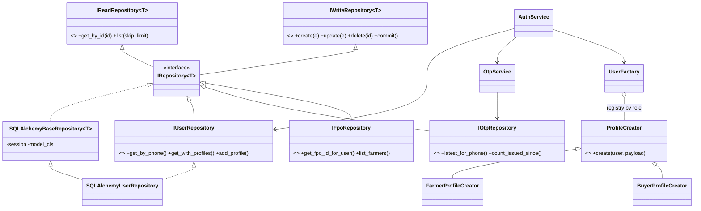

# Member 1 — Implementation Report: Auth, Roles & Generic Repository

> Companion to [LLD_MEMBER_1_AUTH_AND_REPOSITORY.md](LLD_MEMBER_1_AUTH_AND_REPOSITORY.md) (the design).
> This file records **what was actually built**, where it lives, how other members use it, and where the code intentionally differs from the LLD sketch.

**Scope:** Member 1 only. No files belonging to Members 2–5 (lots, grading, matching, offers/escrow, AI/voice) were changed, apart from the two touch-points listed in §6.

---

## 1. Summary

| LLD item | Status | Where |
|---|---|---|
| Generic Repository (`IRepository[T]`, `SQLAlchemyBaseRepository[T]`) | ✅ Done, with ISP split into `IReadRepository` / `IWriteRepository` | `app/repositories/base.py` |
| `UserRepository` (+ OTP, FPO repositories) | ✅ Done | `app/repositories/` |
| Factory Method (`UserFactory`) | ✅ Done, registry-based (OCP) | `app/domain/factories/user_factory.py` |
| `OtpService` (hash, expiry, attempt cap) + **throttle 3 req / 10 min** | ✅ Done (throttle is new) | `app/services/auth_service.py` |
| `AuthService` depending on repository interfaces (DIP) | ✅ Done (was free functions on a raw session) | `app/services/auth_service.py` |
| `POST /api/v1/auth/otp/request` | ✅ Refactored + throttled | `app/routers/auth.py` |
| `POST /api/v1/auth/otp/verify` | ✅ Refactored | `app/routers/auth.py` |
| `POST /api/v1/auth/register` | ✅ Refactored to use `UserFactory` | `app/routers/auth.py` |
| `GET /api/v1/auth/me` | ✅ Refactored | `app/routers/auth.py` |
| `GET /api/v1/fpo/farmers` | ✅ **New endpoint** | `app/routers/fpo.py`, `app/services/fpo_member_service.py` |
| Pytest suite | ✅ 27 tests, all passing, no Postgres needed | `tests/test_member_1_auth_repo.py` |

The existing API contract the frontend relies on is unchanged. Every response keeps its old fields, and new fields are optional additions.

---

## 2. Files

### New
| File | Purpose |
|---|---|
| `app/repositories/__init__.py` | Package exports |
| `app/repositories/base.py` | `IReadRepository[T]`, `IWriteRepository[T]`, `IRepository[T]`, `SQLAlchemyBaseRepository[T]` |
| `app/repositories/user_repository.py` | `IUserRepository` / `SQLAlchemyUserRepository`: `get_by_phone`, `get_with_profiles`, `add_profile` |
| `app/repositories/otp_repository.py` | `IOtpRepository` / `SQLAlchemyOtpRepository`: `latest_for_phone`, `count_issued_since`, `delete_for_phone`, `delete_issued_before` |
| `app/repositories/fpo_repository.py` | `IFpoRepository` / `SQLAlchemyFpoRepository`: `get_fpo_id_for_user`, `list_farmers` |
| `app/dependencies/repositories.py` | FastAPI providers binding interfaces → concrete repos (`get_user_repository`, `get_otp_repository`, `get_fpo_repository`) |
| `app/domain/factories/__init__.py`, `user_factory.py` | `ProfileCreator` (abstract), `FarmerProfileCreator`, `BuyerProfileCreator`, `UserFactory` |
| `app/services/fpo_member_service.py` | `FpoMemberService.list_farmers_for_admin` |
| `tests/test_member_1_auth_repo.py` | 27 tests (factory, repository, OTP, service, HTTP) |

### Modified
| File | Change |
|---|---|
| `app/services/auth_service.py` | Rewritten as `OtpService` + `AuthService` classes with injected repositories; `get_auth_service` provider |
| `app/routers/auth.py` | Thin HTTP layer; depends on `AuthService` via `Depends` |
| `app/dependencies/auth.py` | `get_current_user` loads the user through `IUserRepository`. `require_role` compares roles case-insensitively. |
| `app/schemas/auth.py` | `RegisterRequest`: role is case-insensitive (`farmer` → `FARMER`); new optional `gst_number`, `fpo_id`. `OtpRequestRes`: new `message: "OTP sent"` |
| `app/schemas/user.py` | New `FarmerOut` response model |
| `app/routers/fpo.py` | Added `farmers_router` with `GET /farmers` (existing `/aggregate` untouched) |
| `app/main.py` | One line: mount `fpo.farmers_router` at `/api/v1/fpo` |
| `app/config.py` | OTP policy settings: `OTP_TTL_SECONDS=120`, `OTP_MAX_ATTEMPTS=5`, `OTP_MAX_REQUESTS_PER_WINDOW=3`, `OTP_THROTTLE_WINDOW_SECONDS=600` |
| `scripts/seed_data.py` | One line: give demo FPO admin (user 3) a `Farmer` row with `fpo_id=1` so `/fpo/farmers` (and `/pools/aggregate`) work in the demo |

No DB migration is needed. No table or column was added or changed.

---

## 3. Layered flow





---

## 4. API reference (as implemented)

| Method | Path | Auth | Request | Success | Errors |
|---|---|---|---|---|---|
| POST | `/api/v1/auth/otp/request` | — | `{phone}` | `200 {ok, message, expires_in_s, dev_otp?}` | `429` after 3 requests in 10 min |
| POST | `/api/v1/auth/otp/verify` | — | `{phone, code}` | `200 {token, access_token, token_type, user}` | `401` bad/expired/locked OTP, `404` no such user |
| POST | `/api/v1/auth/register` | — | `{phone, code, name, role, locale?, district_id?, village?, lat?, lng?, company_name?, gst_number?, fpo_id?}` | `201 {token, user}` | `409` phone taken, `401` bad OTP, `400` invalid GST / unknown FPO / non-farmer with `fpo_id` |
| GET | `/api/v1/auth/me` | Bearer | — | `200 {user: {..., farmer_profile, buyer_profile}}` | `401` |
| POST | `/api/v1/auth/locale` | Bearer | `{locale}` | `200 {ok}` | `401` |
| GET | `/api/v1/fpo/farmers` | Bearer, FPO_ADMIN | — | `200 [{user_id, name, phone, district_id, village, fpo_id, verified}]` | `404` if not an FPO admin or admin has no FPO |

`dev_otp` is returned only when `ENV != "production"`.

---

## 5. Design patterns and SOLID, in the code

**Repository Pattern.** `SQLAlchemyBaseRepository[T]` holds the generic CRUD; domain repos add their own queries. Write methods only `flush()`. The request's `get_db` session commits at the end, so User + profile are written atomically. `commit()` exists for the one case that must survive an error response: the OTP attempt counter has to be saved even when we return 401.

**Factory Method.** `UserFactory` keeps a registry `role → ProfileCreator`. `FARMER` and `FPO_ADMIN` map to `FarmerProfileCreator`, and `BUYER` maps to `BuyerProfileCreator`. A new role is one `UserFactory.register("INSPECTOR", InspectorCreator())` call, and `AuthService` is not edited (tested in `test_user_factory_is_open_for_extension`).

| Principle | Concrete evidence |
|---|---|
| **SRP** | `OtpService` handles only codes (hash, TTL, attempts, throttle). `AuthService` orchestrates login and registration. Routers only translate HTTP. Repositories only run queries. |
| **OCP** | New role = new `ProfileCreator` + `register()`. Nothing else changes. |
| **LSP** | `InMemoryUserRepo` (tests) and `SQLAlchemyUserRepository` are interchangeable behind `IUserRepository`; the same `AuthService` passes the full suite with the in-memory one. |
| **ISP** | `IReadRepository` vs `IWriteRepository`; a read-only consumer can depend on the read side alone. |
| **DIP** | `AuthService`, `OtpService`, `FpoMemberService` and `get_current_user` depend on interfaces. Concrete classes are bound only in `app/dependencies/repositories.py`. Tests swap them through `app.dependency_overrides`. |

---

## 6. Deviations from the LLD sketch (intentional)

The LLD document was written as a sketch before checking the live schema. Matching it exactly would have needed migrations and would have broken code owned by other members and the frontend, so I followed the existing schema:

1. **Profile fields.** The LLD puts `name` / `district` on `Farmer` and `gst_number` on `Buyer`. In the real schema `name`, `district_id` and `village` live on `users`, and `buyers` stores only `gst_last4`. The factory validates the full GSTIN format, then keeps only the last 4 characters (minimum PII). The LLD's sample tests were adjusted to match: they assert `farmer.user is user` and `buyer.gst_last4 == "F1Z5"`.
2. **Roles.** `FARMER`, `BUYER`, `FPO_ADMIN` (upper-case, as the frontend and seed data use). Input is case-insensitive. There is no separate `admin` role.
3. **OTP table.** No `used` column was added. A successful login deletes the phone's OTP rows. Older rows stay for the 10-minute window so the throttle can count them, and only the newest code can verify. Failed or expired codes are **not** deleted early, so an attacker can't reset the throttle by burning attempts.
4. **FPO admin linkage.** An FPO admin's FPO comes from their `farmers.fpo_id` row (the same mechanism `/pools/aggregate` already used). Because `/fpo/farmers` exposes member phone numbers, `fpo_id` at registration is accepted **only for FARMER**. Admin linkage is set by an operator or the seed.
5. **Touch-points outside Member 1's files:** `app/main.py` (one `include_router` line) and `scripts/seed_data.py` (one line linking the demo admin to FPO 1). `/pools/aggregate` and `fpo_service.py` are untouched.

---

## 7. How Members 2–5 should use this

```python
# app/repositories/lot_repository.py  (Member 2 — example only, not created)
from app.repositories.base import SQLAlchemyBaseRepository
from app.models.lot import Lot

class LotRepository(SQLAlchemyBaseRepository[Lot]):
    def __init__(self, session):
        super().__init__(session, Lot)

    async def list_for_farmer(self, farmer_id: int): ...
```

- Auth in routers: `user: User = Depends(get_current_user)` or `Depends(require_role("FPO_ADMIN"))`. Always take the caller's ID from this, never from a query param.
- Unauthorized rows → `404`, not `403` (`require_role` already does this).
- Remember: `create/update/delete` **flush**, they don't commit. The request session commits on success.

---

## 8. Tests

`tests/test_member_1_auth_repo.py`, 27 tests:

- **Factory (6):** farmer, buyer (GST → last4), FPO_ADMIN → Farmer, invalid role, invalid GST, OCP extension.
- **Repository (2):** interface segregation and abstractness; real `SQLAlchemyBaseRepository` CRUD on in-memory SQLite (skipped if `aiosqlite` is not installed).
- **OTP (5):** hashing + check, expiry, 5-attempt lockout, 3-per-10-min throttle (and reset after the window), only-latest-code-verifies.
- **AuthService (7):** register farmer/buyer, 409 duplicate, 401 wrong OTP, FPO link rules, OTP login, 404 unknown user.
- **HTTP (7):** OTP request shape, 429 throttle, register → verify → `/me`, bad token 401, `/fpo/farmers` scoped to own FPO and hidden from farmers (404), admin without FPO 404, role taken from DB not JWT claim.

Run:

```bash
pytest tests/test_member_1_auth_repo.py -q
# 27 passed
```

The module overrides conftest's Postgres `setup_db` fixture, so it runs without Docker. `pip install aiosqlite` enables the one SQLite-backed CRUD test.

> Note: the older `tests/test_auth.py` targets a previous password-based API (`/auth/login`, `/users/me` without the `/api/v1` prefix) and needs the Postgres test DB. It was left as-is.

---

## 9. Viva quick answers

- **Why a Factory?** Registration shouldn't know how each role's profile is built. The router asks the factory. Adding a role is one registration and doesn't touch the auth pipeline.
- **Where is DIP visible?** `AuthService.__init__(user_repo: IUserRepository, otp_service, fpo_repo)`. FastAPI injects the SQLAlchemy versions, and the test suite injects in-memory versions with zero changes to service code.
- **Why does the base repo flush instead of commit?** So a User and its Farmer/Buyer profile commit together or not at all. An explicit `commit()` is used only where state must persist despite an error response (the OTP attempt counter).
- **How is OTP abuse limited?** bcrypt-hashed codes, 120 s TTL, 5 attempts per code, 3 codes per phone per 10 min (HTTP 429). Only the newest code is valid.
- **Why 404 instead of 403?** It doesn't confirm that a resource exists to someone who isn't allowed to see it.
