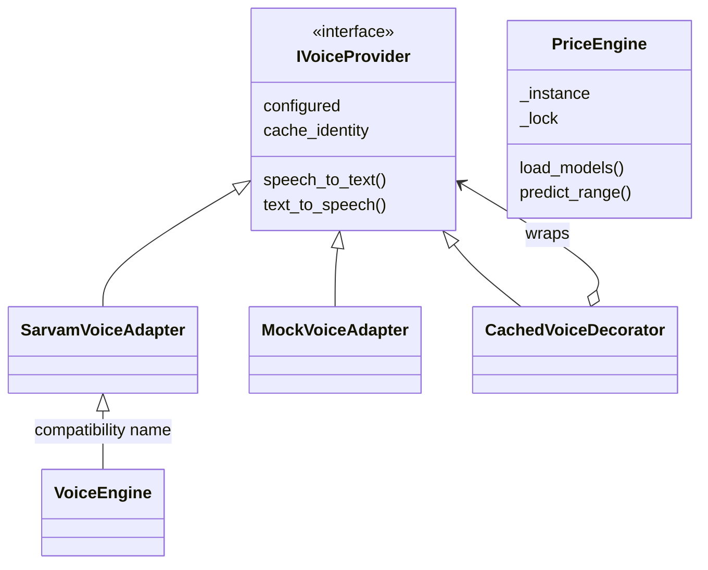

# Member 5 — AI Advisory and Voice Implementation Report

Owner: Nikhil
Branch: `Nikhil/member5-ai-advisory-voice`
Base: `d08867a` (main, including the merged Member 1 implementation)

## Scope and ownership

Implements Member 5's Adapter, Decorator and Singleton responsibilities from
`LLD_IMPLEMENTATION_PLAN.md` and `LLD_MEMBER_5_AI_ADVISORY_AND_VOICE.md`.
Changes are confined to speech adapters/dependency wiring, the voice router,
price/window engines, the AI response schema, Member 5 tests and this report.

The existing forecasting, pledge calculations and logistics endpoint are reused.
No authentication, generic repositories, lot/grading, demand/matching,
offer/escrow, database models/migrations or frontend files are changed.
Other members' APIs and data contracts remain dependencies, not new work here.

## Implemented design

### Adapter

- `app/adapters/voice_provider.py`: abstract speech contract and shared provider error.
- `app/adapters/voice_adapter.py`: Sarvam transport, audio-format detection,
  configured-key checks, response validation and an explicitly selected mock.
- `app/engines/voice_engine.py`: retains `VoiceEngine`, `voice_engine` and
  `VoiceEngineError` imports for compatibility with existing callers/tests.
- `app/dependencies/voice.py`: composition root; the router depends on
  `IVoiceProvider` via FastAPI `Depends(get_voice_provider)`.

The interface deliberately returns dictionaries matching the existing public
API rather than the plan's illustrative string/raw-bytes signatures. Sarvam TTS
returns audio inside JSON, so preserving base64 WAV avoids breaking clients.
The mock returns a small valid silent WAV and a fixed transcript; it is a test
double, not speech synthesis or an automatic production fallback.

### Decorator

`CachedVoiceDecorator` wraps any provider implementing the interface. TTS cache
keys hash provider identity (endpoint/model/speaker), language and exact text.
Cached responses are stored outside the repository under the OS temporary
folder's `krishi-mitr-voice` directory. Files are written through private
unique temporary files and atomically replaced, avoiding partial JSON during
concurrent writes. Disk work runs off the async event loop.

A hit survives decorator recreation. Corrupt entries regenerate; upstream
exceptions and malformed WAV payloads are not cached. A failed cache write does
not fail successful speech. STT is delegated without caching recordings.
`VOICE_CACHE_ENABLED=False` selects the undecorated provider using the existing
setting; no shared configuration file change is needed.

The cache has no expiry/eviction policy and concurrent misses may duplicate
upstream requests. It is local to a host, not shared between deployment workers
on different hosts. Cached WAV responses can be reused without synthesis, but
the public routes still require a configured provider. Full offline playback
continues to belong to the existing device/browser voice fallback.

### Singleton

`PriceEngine()` returns the same process-local instance. An `RLock` protects
construction and model initialization. Repeated construction preserves loaded
models, and repeated `load_models()` calls do not repeat the initialization
attempt. Each server process has its own singleton. Existing model preference,
quantile inference and fallback behavior are retained.

### Advisory response corrections

`window_engine.py` now passes the decision engine's sell-now and hold p10/p50
net values directly to the API. Previously it recomputed hold nets, subtracted
costs again and replaced the itemized total while omitting transport/commission.
The response now preserves the domain result and its existing cost breakdown.
No grading, crop valuation rules or lot services are changed.

`WindowRes.refusal_reason` now permits `MODEL_UNAVAILABLE`; the domain already
returns it, but the schema previously rejected it and could produce HTTP 500.
The voice adapter also returns the requested narration language instead of
letting the schema default every narration response to Marathi.

## API behavior

| Endpoint | Result |
| --- | --- |
| `GET /api/v1/ai/forecast` | Existing quantile response retained |
| `POST /api/v1/ai/window/recommend` | Existing recommendations; consistent domain net values; missing-model refusal serializes |
| `POST /api/v1/voice/transcribe` | Existing multipart/file/audio/raw-body transport; injected provider; 503 when unconfigured, 502 on provider failure |
| `POST /api/v1/voice/narrate` | Existing `{text, locale}` request and base64 WAV JSON; cached synthesis; correct language metadata |
| `GET /api/v1/logistics/nearby` | Existing endpoint reused without edits |

## SOLID evidence

- **SRP:** provider transport, disk cache and HTTP handling have separate owners.
- **OCP:** another voice vendor can implement `IVoiceProvider` and use the same decorator/router.
- **LSP:** live, mock and decorated providers share callable signatures and response shapes.
- **ISP:** the provider exposes speech operations plus configuration/cache identity, without database methods.
- **DIP:** HTTP handlers consume the provider interface; tests override the composition dependency.

## Verification

`python3 -m pytest tests/test_member_5_ai_voice.py -q --disable-warnings`

26 tests passed, covering:

- Persisted cache hits, language/text/model isolation, corruption, invalid audio,
  failed writes, provider failures, STT delegation and concurrent atomic writes.
- Marathi/Hindi/English API requests using injected providers, missing input,
  unavailable configuration and upstream failure status codes.
- Malformed provider responses, explicit mock selection and cache setting behavior.
- Singleton identity and one-time initialization; fourteen-day fallback quantile ordering.
- Forecast HTTP contract, advisory gain/cost consistency, pledge interest/gain gate,
  and missing-model `NO_ADVICE` through the HTTP endpoint.

Regression checks:

- Existing Member 1 suite: **26 passed, 1 skipped** (optional SQLite dependency).
- Existing voice, decision, domain and ML suites: **53 passed**. These four
  existing test files were copied unchanged to a temporary test directory and
  run with the repository on `PYTHONPATH` and `--confcutdir` set to that directory.
  This avoids the shared autouse Postgres create/drop fixture without modifying
  another member's tests or shared `tests/conftest.py`.
- `git diff --check` passed.

No live Sarvam requests, production deployment, payment operation or database
migration was performed. Provider requests were mocked in verification. Existing
Pydantic deprecation warnings are outside this change's scope.

## Existing limitations retained

The frontend still uses fixture-driven advisory data. This PR does not connect
or modify frontend screens. Existing hardcoded model-card metrics, fallback
forecast provenance behavior, integer-quintal rounding and request horizon
behavior are not redesigned here. No new NLP intent classifier, database schema,
loan disbursement, escrow feature or other member's planned pattern is included.

For viva: explain Adapter as translating provider transport to the app's stable
speech contract, Decorator as adding cache behavior without changing the vendor
adapter, and Singleton as sharing model initialization within one process.
The actual Maharashtra predictor uses exponential uncertainty bands; the plan's
additive `p50 ± 1.28σ` example is illustrative, not this implementation's formula.
