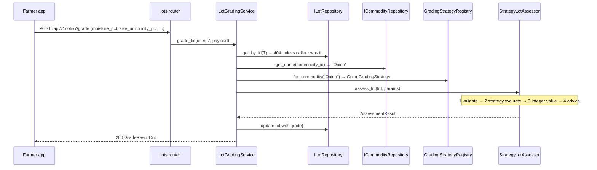
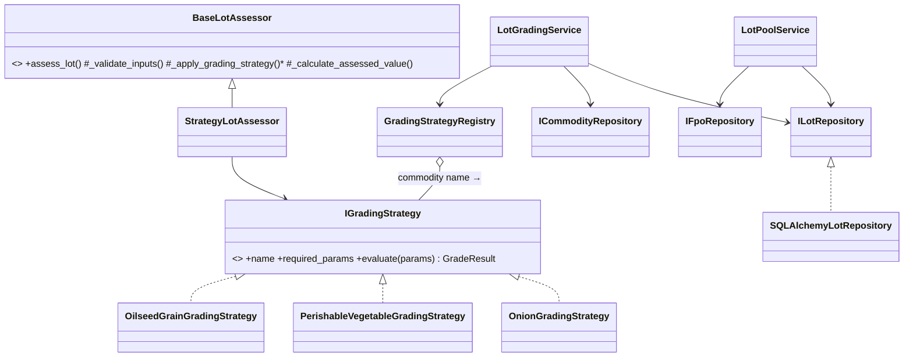

# Pranay — Implementation Report: Lots, Grading & FPO Pooling

> Companion to the Lots & Grading LLD (the design).
> This file records what was built, where it lives, and where it differs from the LLD sketch.

**Scope:** lots, grading and FPO pooling only. Nothing owned by other team members was changed. `app/main.py` and `scripts/seed_data.py` were not touched. No migration is needed.

---

## 1. Summary

| LLD item | Status | Where |
|---|---|---|
| Strategy Pattern: `IGradingStrategy`, `GradeResult` | ✅ Done | `app/engines/strategies/grading_strategy.py` |
| `OnionGradingStrategy` (LLD code) | ✅ Done, plus extra tips | same |
| `PerishableVegetableGradingStrategy` | ✅ Done (decay, size, discoloration) | same |
| `OilseedGrainGradingStrategy` | ✅ Done (moisture, foreign matter, damage) | same |
| Commodity → strategy lookup | ✅ New `GradingStrategyRegistry` covers all 14 seeded crops | same |
| Template Method: `BaseLotAssessor.assess_lot()` | ✅ Done, plus `StrategyLotAssessor` | `app/engines/lot_assessor.py` |
| Lot lifecycle (`available → locked → sold`) | ✅ Done as a transition table | `app/domain/lot_lifecycle.py` |
| `LotRepository` on Member 1's base repo | ✅ `ILotRepository`, `ICommodityRepository` + SQLAlchemy versions | `app/repositories/lot_repository.py` |
| `POST /api/v1/lots/{id}/grade` | ✅ **New** | `app/routers/lots.py`, `app/services/lot_grading_service.py` |
| `POST /api/v1/fpo/lots/pool` | ✅ **New** | `app/routers/fpo.py`, `app/services/lot_pool_service.py` |
| `POST /api/v1/pools/aggregate` (existing) | ✅ **Fixed**. It crashed on every call before. | same service |
| `POST /lots`, `GET /lots`, `GET /lots/{id}` | ✅ Already existed, left unchanged | `app/services/lot_service.py` |
| Pytest suite | ✅ 46 tests, no Postgres needed | `tests/test_pranay_lots_grading.py` |

---

## 2. Files

### New
| File | Purpose |
|---|---|
| `app/engines/strategies/__init__.py` | Package exports |
| `app/engines/strategies/grading_strategy.py` | `GradeResult`, `IGradingStrategy`, 3 strategies, `GradingStrategyRegistry`, `build_default_registry()` |
| `app/engines/lot_assessor.py` | `BaseLotAssessor` (template method), `StrategyLotAssessor`, `AssessmentResult`, `GradingInputError` |
| `app/domain/lot_lifecycle.py` | Status constants, allowed transitions, `transition()` |
| `app/repositories/lot_repository.py` | `ILotRepository`, `ICommodityRepository` and SQLAlchemy implementations |
| `app/services/lot_grading_service.py` | `LotGradingService.grade_lot()` |
| `app/services/lot_pool_service.py` | `LotPoolService.pool()` |
| `app/dependencies/lots.py` | FastAPI providers that bind the interfaces to concrete classes |
| `tests/test_pranay_lots_grading.py` | 46 tests |

### Modified (all in the lots / grading / pooling area)
| File | Change |
|---|---|
| `app/routers/lots.py` | Added `POST /{lot_id}/grade`. Fixed photo upload: it set `photo_path` on a response object instead of the DB row, so the photo was never saved. It now writes `lot.image_url` and only the owner can upload. |
| `app/routers/fpo.py` | Added `POST /lots/pool` on the router mounted at `/api/v1/fpo`. `/pools/aggregate` now uses `LotPoolService`. Member 1's `/fpo/farmers` route is untouched. |
| `app/services/fpo_service.py` | The old body used `lot.crop`, `lot.quantity_kg` and `price_*_paise_per_qtl`, which don't exist on `Lot`, so it always failed. It now delegates to `LotPoolService`. |
| `app/schemas/lot.py` | Added `GradeRequest`, `GradeResultOut`, `PoolRequest`. `LotOut.status` also accepts `OFFERED` and `POOLED` (both already in the frontend's `LotStatus` type), and maps DB `locked → OFFERED`. |

`POST /lots/{id}/assay` and `app/engines/grading_engine.grade()` are **unchanged**. The frontend's six-question self-assay screen (S20) depends on them.

---

## 3. How a grade request flows





---

## 4. API reference (as built)

### `POST /api/v1/lots/{id}/grade`. Auth: FARMER or FPO_ADMIN (owner only)

Request (all percentages, 0–100; which fields are required depends on the crop):
```json
{"moisture_pct": 12.5, "foreign_matter_pct": 1.2, "size_uniformity_pct": 88}
```
| Strategy | Crops | Required | Optional |
|---|---|---|---|
| `onion` | Onion | `moisture_pct`, `size_uniformity_pct` | — |
| `perishable_vegetable` | Tomato, Potato, Green Chilli, Banana | `damage_pct`, `size_uniformity_pct` | `discoloration_pct` |
| `oilseed_grain` | Soyabean, Wheat, Bengal Gram, Maize, Rice, Groundnut, Jowar, Cotton, Turmeric | `moisture_pct`, `foreign_matter_pct` | `damage_pct` |

Response `200`:
```json
{"lot_id": "7", "commodity": "Onion", "strategy": "onion", "grade": "B",
 "assessed_multiplier": 0.85, "assessed_price_paise_per_qtl": 187000,
 "assessed_value_paise": 4675000,
 "advice": ["Cure a little longer in shade to bring moisture below 12% for Grade A."]}
```
Errors: `404` if the lot is not yours or doesn't exist, `409` if the lot is not active, `422` for a missing, negative or above-100 parameter or a crop with no rules.

### `POST /api/v1/fpo/lots/pool`. Auth: FPO_ADMIN
Request: `{"lot_ids": [101, 102, 103], "fpo_id": 1}` (`fpo_id` is optional and must match your own FPO).
Response `201` `BatchLotOut`: `{id, commodity_id, quantity_qtl, grade, expected_price_paise, status, member_lots: [{source_lot_id, quantity_contributed_qtl}]}`.

Rules:
- At least 2 distinct lots.
- Every lot must belong to a farmer in **your** FPO. Otherwise the response is `404`.
- All lots must be the same commodity (`400`) and still active (`409`).
- Batch quantity is the sum of the lots.
- Batch grade is the **lowest** member grade, or ungraded if any member is ungraded.
- Batch price is the quantity-weighted average, in integer paise.
- Source lots become `pooled`.

`POST /api/v1/pools/aggregate` (`{"lot_ids": [...]}`) uses the same service.

---

## 5. Design patterns and SOLID, in the code

| Principle | Evidence |
|---|---|
| **SRP** | Strategies only judge quality. `BaseLotAssessor` only orders the steps. `lot_lifecycle` only decides legal status moves. Services orchestrate. Routers only do HTTP. |
| **OCP** | A new crop is one new `IGradingStrategy` class plus `registry.register(...)`. Tested in `test_new_crop_is_added_without_touching_existing_code`. |
| **LSP** | Any strategy can be passed to `StrategyLotAssessor`. The same assessor is tested with all three. |
| **ISP** | `IGradingStrategy` exposes only `evaluate()` and two descriptive attributes, with no DB or HTTP methods. |
| **DIP** | `LotGradingService` and `LotPoolService` take `ILotRepository` / `ICommodityRepository` / `IFpoRepository`. Concrete classes are bound only in `app/dependencies/lots.py`. Tests inject in-memory repos. |

**Money:** assessed value = `price * bps // 10000` (A = 10000, B = 8500, C = 7000 bps), integers only. The float `assessed_multiplier` (1.0 / 0.85 / 0.70) is returned for display, and the LLD tests check it, but it is never used for money.

---

## 6. Deviations from the LLD sketch (intentional)

1. **Column names follow the live schema, not the LLD table.** `Lot.grade`, not `quality_grade`. `BatchLotMember.batch_lot_id` / `quantity_contributed_kg`, not `fpo_batch_id` / `allocated_quantity_qtl`. The API reports quintals and stores `qtl × 100` in the kg column. `Commodity` has `storable_days`, and no `grade_standard_json` was added, because grading rules live in code (strategies). Renaming columns would have needed migrations and would have broken Members 3 and 4.
2. **Status names.** The LLD says `available`. The DB and seed data already use `active`, so the lifecycle is `active → locked → sold`, plus `pooled` and `cancelled`.
3. **Onion strategy has no default values.** The LLD sketch defaults moisture to 10% if missing, which would hand out Grade A for missing data. Missing required parameters now return `422`.
4. **Pooling endpoint.** It is added on the router already mounted at `/api/v1/fpo`, so `main.py` did not change. The FPO is taken from the logged-in admin, never from the body.
5. **`POST /lots`, `GET /lots`, `GET /lots/{id}`** already existed in `lot_service.py` and work. They were left as they are, to avoid touching code Members 3 and 4 also call (`get_lot_matches`, `get_price_suggestion`). The new repository layer is used by the new grading and pooling services.
6. **Thresholds** are simplified prototype values modelled on AGMARKNET-style specs, not the official notified grade standards.

---

## 7. Tests

`tests/test_pranay_lots_grading.py`, 46 tests:
- **LLD §6 (3):** onion A, B with tips, C. The tests are copied verbatim.
- **Strategies (11):** grain and perishable grade tables, advice on every non-A grade.
- **Registry (2):** lookup by name, OCP extension.
- **Assessor (7):** full template run, integer rounding, no price, validation (negative, above 100, missing, non-number).
- **Lifecycle (3):** legal and illegal moves, release from locked, `LotOut` status mapping.
- **Grading service (6):** saves the grade, picks the crop strategy, 404 for another farmer's lot, 409, 422.
- **Pool service (10):** happy path (sum, lowest grade, weighted price, kg column, source lots pooled), ungraded batch, and 404 / 400 / 409 cases.
- **HTTP (5):** `/lots/{id}/grade`, range and ownership errors, `/fpo/lots/pool`, `/pools/aggregate`, a farmer can't pool.

```bash
pytest tests/test_pranay_lots_grading.py -q        # 46 passed
pytest tests/test_member_1_auth_repo.py tests/test_member_5_ai_voice.py tests/test_pranay_lots_grading.py -q   # 99 passed
```

> `tests/test_grading.py` is older: it needs the Postgres test DB and tests an earlier version of `grade()` (`improvement_tip`, string answers). It fails the same way before and after this change, and was left as it is.

---

## 8. Viva quick answers

- **Why Strategy and not if/elif?** Each crop's rules live in their own class. Adding soybean rules can't break onion grading, and each class is tested alone.
- **What does the Template Method protect?** The order: validate, then grade, then value, then advise. A subclass can change *how* a crop is graded, but it can't skip validation or change the money formula.
- **Why integer basis points?** `0.85 * price` in floats can produce values like `186999.99999`. `price * 8500 // 10000` is exact and always rounds down, in the farmer's favour of never over-promising.
- **Why does a batch take the lowest grade?** A buyer of a pooled lot receives all of it. Calling it Grade A when one part is C would be a false claim and would lead to disputes.
- **Why 404 when pooling another FPO's lots?** It doesn't confirm to an outsider that those lots exist.
