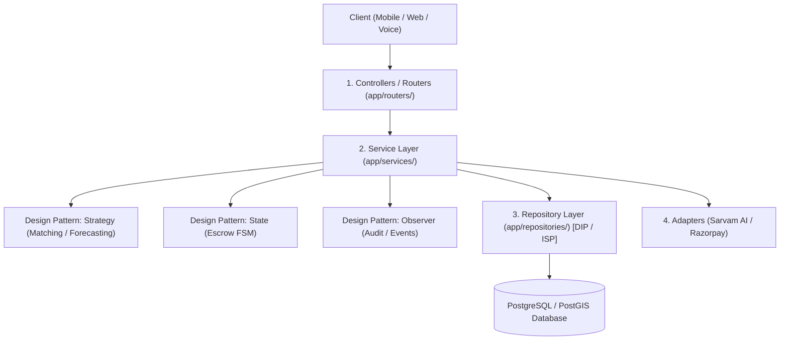
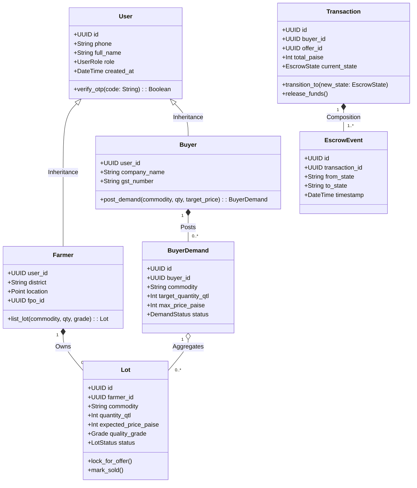
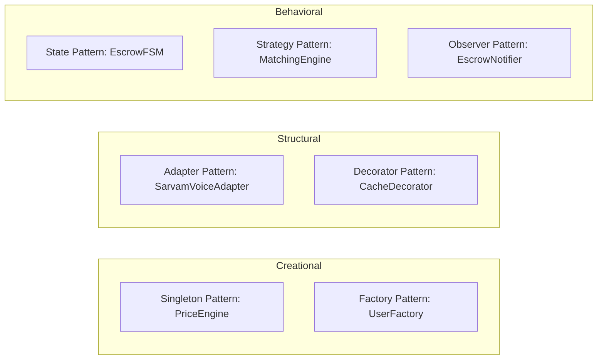
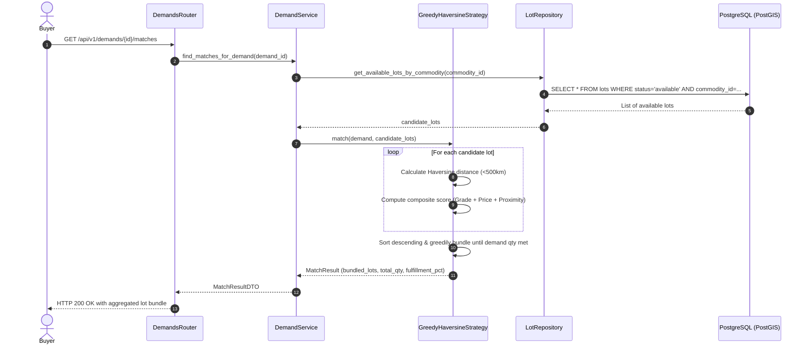
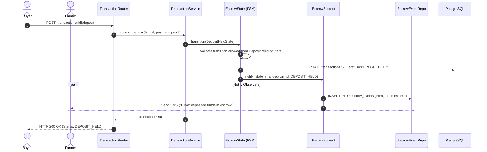
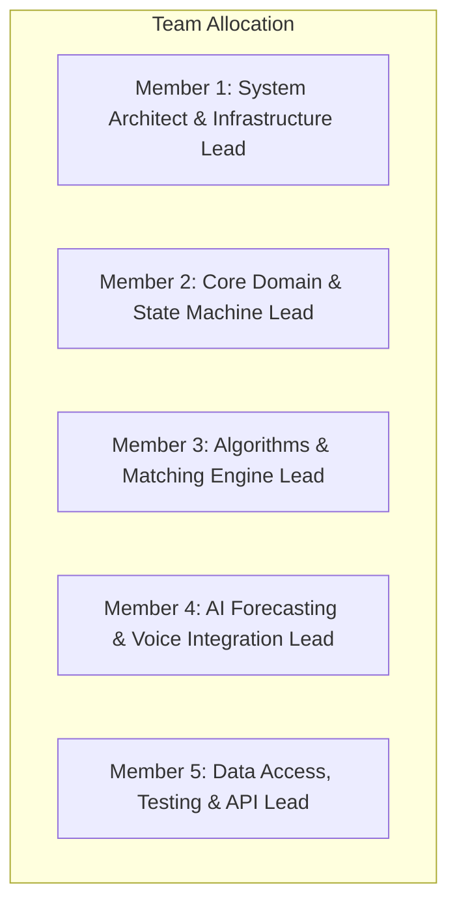

# Krishi-Mitr (AgriSense / Neolithic)
## Low-Level Design (LLD) & System Design Comprehensive Blueprint

> **Capstone Project Evaluation Preparation Guide**  
> **Team Size:** 5 Members  
> **Evaluation Date:** First Week of November  
> **Target:** 10/10 fulfillment across all 10 Academic System Design / LLD Criteria

---

## Executive Summary: The 3 Core Questions Answered

### Question 1: Is there anything we CANNOT put/integrate as per LLD requirements? Is there anything we cannot fulfill while sticking to project features?
**Verdict: 100% NO. There is NOTHING you cannot fulfill.**
Your project (*Krishi-Mitr*) is actually an ideal candidate for an advanced LLD evaluation. It has real multi-actor workflows (Farmers, Institutional Buyers, FPOs, Logistics Providers), real algorithmic complexity (Greedy Multi-Lot Aggregation, 14-Day Quantile Forecasting), real financial risk (Escrow payments, deposit locks, dispute arbitration), and real infrastructure (PostgreSQL/PostGIS, Redis, Celery).

The only reason students struggle in academic LLD evaluations is **architectural style**, not project features:
- In production Python/FastAPI, developers often write *procedural services* (functions doing DB queries).
- University evaluators, however, grade on classic **Gang of Four (GoF) Object-Oriented Design**: Abstract Base Classes, Interfaces, strict Polymorphism, State Pattern, Strategy Pattern, Observer Pattern, Repository Pattern, and SOLID principles.
- **We do not need to change a single feature or throw away any code.** We simply formalize and wrap the existing business logic into classic OOP classes and design patterns.

---

### Question 2: What all do we have to do to fulfill our System Design requirements?
To score full marks, the team needs to deliver two synchronized outputs:
1. **Code-Level LLD Refactoring (Pure OOP)**:
   - **Repository Pattern (`app/repositories/`)**: Decouple SQLAlchemy queries from service logic (`IBaseRepository`, `LotRepository`, `TransactionRepository`).
   - **State Pattern (`app/domain/states/`)**: Transform the escrow transition dictionary into formal polymorphic state classes (`EscrowState`, `DepositHeldState`, `InTransitState`, `InspectedState`, `FundsReleasedState`).
   - **Strategy Pattern (`app/engines/strategies/`)**: Formalize the matching engine into interchangeable strategies (`IMatchingStrategy`, `GreedyHaversineStrategy`, `FastClearanceStrategy`).
   - **Observer Pattern (`app/events/`)**: Decouple escrow state changes from notifications and logging (`EscrowSubject`, `SMSObserver`, `AuditLogger`).
   - **Adapter Pattern (`app/adapters/`)**: Wrap third-party services (Sarvam AI STT/TTS, Razorpay).
2. **LLD Presentation & Documentation Package**:
   - Master UML Class Diagram (with methods, attributes, multiplicities, inheritance, composition, and interfaces).
   - 3 Detailed UML Sequence Diagrams (Matching, Escrow, AI Sale Window).
   - 2 Activity Diagrams (Lot Grading Workflow, Dispute Resolution).
   - SOLID Principles Defense Matrix (citing exact classes and files).
   - Design Patterns Justification Catalog.

---

### Question 3: What all is already done vs. What has to be done?

| Component / Evaluation Metric | Current Status in Codebase | What Has to Be Done for Evaluation |
| :--- | :--- | :--- |
| **1. Requirements Analysis** | Complete in PRDs (`Details/`, `complete_solution_context/`) | Condense into formal FR/NFR, Actor definitions, and Use Case specifications for the final deck. |
| **2. Class Diagram** | 25 DB models exist in SQLAlchemy (`app/models/`) | Convert into a formal UML Class Diagram with visibilities (`+`, `-`), methods, associations, composition, and interfaces. |
| **3. Object-Oriented Design** | Partial (Models are OOP; services are mostly functional) | Introduce `abc.ABC` base classes, interfaces (`Protocol`/`ABC`), and polymorphic method dispatch. |
| **4. SOLID Principles** | Informally present (FastAPI DI, single-purpose routers) | Create explicit Repository interfaces (DIP, ISP), Strategy classes (OCP), and state hierarchies (LSP). |
| **5. Design Patterns** | Singleton & FSM present informally | Formalize 5 classic GoF patterns: **State, Strategy, Observer, Factory, Adapter, Singleton**. |
| **6. Sequence / Activity Diagrams** | High-level architecture diagrams exist in PRDs | Draw exact UML Sequence & Activity diagrams tracing method calls between Controller $\to$ Service $\to$ Repository $\to$ Database. |
| **7. API / Interface Design** | 44 REST APIs fully functional in FastAPI + Pydantic | Document standard controller-service-repository layered contracts. |
| **8. Database Schema** | 25 models, PostGIS geometry, Alembic migrations complete | Provide clean relational ER Diagram with keys, constraints, and spatial indexes. |
| **9. Error Handling & Edge Cases** | Pydantic validation, `409 INVALID_TRANSITION`, `ErrorHandlerMiddleware` | Document concurrency guards, validation exception matrix, and retry logic. |
| **10. Working Implementation** | Full Docker stack (7 containers), frontend, backend, live at `krishimitr.in` | Prepare a seamless live demo script dividing speaking roles among all 5 members. |

---

## Detailed Mapping of the 10 Faculty Evaluation Criteria



---

### Criterion 1: Requirement Analysis
#### 1. System Actors
- **Farmer / FPO (Seller)**: Lists agricultural produce lots, undergoes AI/rule-based grading, seeks price advice (Sell vs Hold), negotiates buyer offers, pledges warehouse receipts.
- **Buyer (Processor / Trader / Retailer)**: Posts bulk procurement demands, receives algorithmically bundled lot matches, submits counter-offers, deposits escrow funds, inspects delivery.
- **Logistics & Cold Storage Operator**: WDRA-registered warehouse operator providing storage quotes; transport operator confirming transit milestones.
- **Admin / Arbitrator**: Oversees platform integrity, reviews dispute claims, inspects evidence, arbitrates escrow payouts.
- **External AI & Financial Services**: Sarvam AI (ASR/TTS voice interface), Razorpay/Escrow Gateway, IMD Weather Service, AGMARKNET Mandi data.

#### 2. Functional Requirements (FRs)
- **FR1 (Lot Lifecycle & Grading)**: System must allow farmers to list lots with commodity, quantity, and grade attributes, calculating an assessed quality grade (A, B, C) and improvement tips.
- **FR2 (Price Forecasting & Window Advisory)**: System must output 14-day quantile price projections ($p10, p50, p90$) and calculate net holding profit vs. immediate selling.
- **FR3 (Smart Demand Aggregation & Matching)**: System must match buyer demands to multiple farmer lots within a 500 km radius based on composite scoring (grade, price, proximity).
- **FR4 (Bargaining & Offer Threads)**: System must maintain threaded bilateral counter-offers between buyers and farmers with status tracking.
- **FR5 (Escrow Payment & State Machine)**: System must enforce milestone-based fund locks, transit updates, inspection sign-offs, and automated release.
- **FR6 (Trilingual Voice Interaction)**: System must accept audio input and synthesize speech output in Hindi and Marathi with audio caching for offline playback.

#### 3. Non-Functional Requirements (NFRs)
- **NFR1 (Performance)**: Read API response time $< 10\text{ms}$ for cached mandi discovery; P95 response time $< 100\text{ms}$ on database queries.
- **NFR2 (Accuracy & Consistency)**: Zero floating-point rounding errors in escrow transactions (guaranteed by integer paise). Quantile forecasts must strictly enforce $p10 \le p50 \le p90$.
- **NFR3 (Concurrency & Safety)**: Prevention of double-allocation when matching lots across concurrent buyer demands via atomic state locking.
- **NFR4 (Resilience & Offline Operation)**: TanStack React Query debounced local storage persistence; cached audio playback without active internet.

---

### Criterion 2 & 3: Class Diagram & Object-Oriented Design

The design incorporates formal OOP concepts:
- **Encapsulation**: Private state fields, protected helper methods, public service interfaces.
- **Abstraction**: Abstract classes (`BaseRepository[T]`, `MatchingStrategy`, `EscrowState`, `VoiceProvider`).
- **Inheritance**:
  - `User` $\to$ `Farmer`, `Buyer`.
  - `EscrowState` $\to$ `DepositPendingState`, `DepositHeldState`, `InTransitState`, `InspectedState`, `FundsReleasedState`.
- **Polymorphism**: `MatchingStrategy.execute(demand, candidate_lots)` invokes different scoring routines depending on runtime strategy injection.
- **Relationships**:
  - *Composition*: `Transaction` *-- `EscrowEvent` (an event cannot exist without its transaction).
  - *Aggregation*: `BuyerDemand` o-- `Lot` (lots exist independently of a demand bundle).
  - *Association*: `Farmer` -- `MandiLocation` (farmer associates with their nearest APMC).



---

### Criterion 4: SOLID Principles Defense Matrix

| Principle | Where Applied in Krishi-Mitr | Concrete Code Justification |
| :--- | :--- | :--- |
| **S - Single Responsibility** | Layered Separation of Concerns | `app/routers/lots.py` handles HTTP request parsing and status codes only. `app/services/lot_service.py` handles authorization and lot validation. `app/repositories/lot_repo.py` handles SQL queries. |
| **O - Open/Closed Principle** | Matching & Pricing Strategies | The `MatchingEngine` delegates to an `IMatchingStrategy`. If we add a new `PerishableCropStrategy` (prioritizing shelf life), we create a new class without modifying existing engine code. |
| **L - Liskov Substitution** | State Machine & User Subtypes | Any state class (`DepositHeldState`, `InTransitState`) implements `IEscrowState`. The `TransactionService` interacts with `IEscrowState` without needing to know concrete state classes. |
| **I - Interface Segregation** | Fine-grained Repository Interfaces | Instead of one monolithic database class, repositories are split: `IReadRepository[T]` (fetch by id, list) and `IWriteRepository[T]` (create, update, delete). Services only depend on methods they need. |
| **D - Dependency Inversion** | Dependency Injection in FastAPI | High-level services (`TransactionService`) depend on abstract repository interfaces (`ITransactionRepository`), not directly on AsyncPG or SQLAlchemy engine instances. |

---

### Criterion 5: Gang of Four (GoF) Design Patterns



#### 1. State Pattern (Behavioral) — *Core USP*
- **Purpose**: Manages the multi-step lifecycle of an Escrow Transaction.
- **Problem Solved**: Replaces large, error-prone `if/elif/else` statements and ensures invalid state transitions cannot happen.
- **Implementation**:
  - Interface: `IEscrowState` with methods `deposit_funds()`, `dispatch_goods()`, `confirm_inspection()`, `release_payout()`, `raise_dispute()`.
  - Concrete Classes: `DepositPendingState`, `DepositHeldState`, `InTransitState`, `InspectedState`, `FundsReleasedState`, `DisputedState`.
  - When `confirm_inspection()` is called on `DepositPendingState`, it raises `InvalidTransitionException` (HTTP 409).

#### 2. Strategy Pattern (Behavioral)
- **Purpose**: Dynamic scoring and ranking of candidate lots to fulfill buyer demand.
- **Problem Solved**: Different commodities need different matching logic (e.g., highly perishable onions need proximity prioritization; non-perishable grains prioritize price).
- **Implementation**:
  - Interface: `IMatchingStrategy` defining `match(demand: BuyerDemand, candidate_lots: List[Lot]) -> MatchResult`.
  - Concrete Strategies:
    - `GreedyHaversineStrategy`: Balanced weighting (40% Grade, 30% Price, 30% Distance within 500 km).
    - `FastClearanceStrategy`: Highly weighted on distance (< 100 km) and immediate pickup.
    - `PriceOptimizedStrategy`: Prioritizes lowest price per quintal.

#### 3. Observer Pattern (Behavioral)
- **Purpose**: Event-driven decoupling of transaction status changes.
- **Problem Solved**: When escrow transitions from `IN_TRANSIT` $\to$ `INSPECTED`, multiple secondary tasks must occur (send SMS to farmer, notify buyer app, write immutable audit record to `escrow_events`).
- **Implementation**:
  - Subject: `EscrowTransactionSubject` (`attach()`, `detach()`, `notify()`).
  - Observers: `AuditLogObserver`, `SmsNotificationObserver`, `LotStatusSyncObserver`.

#### 4. Singleton Pattern (Creational)
- **Purpose**: Global single-instance resource management.
- **Application**:
  - `PriceEngine` (`app/engines/price_engine.py`): Heavy LightGBM machine learning models loaded into RAM once at application startup.
  - `DatabasePool` (PgBouncer connection manager) and `RedisCacheClient`.

#### 5. Adapter Pattern (Structural)
- **Purpose**: Decoupling vendor-specific APIs from internal domain logic.
- **Application**:
  - `IVoiceProvider` interface implemented by `SarvamVoiceAdapter`. If the platform switches from Sarvam AI to Google Cloud Speech or Bhashini, only the adapter is swapped.
  - `IPaymentGateway` interface implemented by `RazorpayAdapter` (and `MockPaymentAdapter` for testing).

#### 6. Factory Method Pattern (Creational)
- **Purpose**: Instantiating domain objects based on dynamic inputs.
- **Application**: `UserFactory.create_user(role, data)` instantiating either `Farmer` or `Buyer` with their respective profile relationships.

---

### Criterion 6: Sequence Diagrams

#### Sequence Diagram: Multi-Lot Smart Matching Flow


#### Sequence Diagram: Escrow State Machine Lifecycle


---

### Criterion 7 & 8: API Design & Database Schema

#### Clean 3-Tier Layered Architecture
1. **Presentation / Transport Layer (`app/routers/`)**:
   - Pure HTTP concerns: routing, status codes, query params, auth dependency injection (`Depends(get_current_user)`).
   - Validates input and output schemas using Pydantic.
2. **Business / Domain Layer (`app/services/` & `app/engines/`)**:
   - Zero awareness of HTTP requests or responses.
   - Executes domain rules, state transitions, scoring algorithms, and financial validations.
3. **Data Access Layer (`app/repositories/` & `app/models/`)**:
   - Encapsulates database queries, PostGIS geospatial filters, and ORM operations.

#### Database Relational Schema & Indexing (PostgreSQL + PostGIS)
- **Primary Keys**: UUID / BigInt with auto-increment sequences.
- **Foreign Key Integrity**: Enforced across `User` $\to$ `Farmer`/`Buyer`, `Transaction` $\to$ `EscrowEvent`, `Offer` $\to$ `OfferLot`.
- **Spatial Indexing**: `GIST` indexing on PostGIS `POINT` columns:
  ```python
  geom = Column(Geometry('POINT', srid=4326), nullable=True, index=True)
  ```
- **Performance Indexes**: B-Tree indexes on `phone`, `status`, `commodity_id`, and composite index on `(commodity_id, status)`.

---

### Criterion 9: Error Handling, Validation & Concurrency

1. **Structured Exception Hierarchy**:
   - Custom exceptions inheriting from `BaseDomainException`:
     - `InvalidStateTransitionException` $\to$ maps to HTTP 409 Conflict.
     - `LotAlreadyAllocatedException` $\to$ maps to HTTP 409 Conflict.
     - `InsufficientInventoryException` $\to$ maps to HTTP 422 Unprocessable Entity.
     - `EntityNotFoundException` $\to$ maps to HTTP 404 Not Found.
2. **Global Middleware Exception Handler (`ErrorHandlerMiddleware`)**:
   - Traps unhandled exceptions and formats all API error responses into an immutable, standard contract:
     ```json
     {
       "error": {
         "code": "INVALID_TRANSITION",
         "message": "Cannot transition transaction from CREATED directly to FUNDS_RELEASED.",
         "details": {"current_state": "CREATED", "requested_state": "FUNDS_RELEASED"}
       }
     }
     ```
3. **Concurrency & Race Condition Defenses**:
   - **Atomic State Transitions**: Prevent double-allocation of farmer lots when two buyers accept matching offers simultaneously.
   - **PgBouncer Connection Pooling**: Prevents connection exhaustion under high client concurrency (`MAX_CLIENT_CONN=1000`, `DEFAULT_POOL_SIZE=20`).

---

## Team Division: 5 Members Work Allocation

To ensure every member has a clear, demonstrable contribution during the faculty evaluation, divide the responsibilities across 5 functional pillars:



### Member 1: System Architect & Infrastructure Lead
- **Primary Responsibilities**:
  - Docker Compose topology (7 services: Nginx, FastAPI, PostgreSQL, PgBouncer, Redis, Celery, MinIO).
  - Reverse proxy configuration (Nginx SSL, Gzip, rate limiting, routing).
  - Requirement analysis (FRs, NFRs, system actors) and deployment at `krishimitr.in`.
- **Evaluation Presentation Topics**:
  - Walkthrough of architecture diagram, Docker container orchestration, PgBouncer pool mechanics, and production security/deployment.

### Member 2: Core Domain & Escrow State Machine Lead
- **Primary Responsibilities**:
  - Formal implementation of the **State Pattern** for the Escrow Lifecycle.
  - Implementation of the **Observer Pattern** for audit logging and milestone notifications.
  - Financial safety design (exact integer paise arithmetic).
- **Evaluation Presentation Topics**:
  - Walkthrough of State Diagram, FSM transition guards, `409 INVALID_TRANSITION` defenses, and escrow event auditability.

### Member 3: Algorithms & Matching Engine Lead
- **Primary Responsibilities**:
  - Formal implementation of the **Strategy Pattern** for multi-lot demand matching.
  - Geospatial distance calculation (Haversine formula within 500 km limit).
  - Multi-attribute greedy knapsack aggregation logic (Grade, Price, Proximity).
- **Evaluation Presentation Topics**:
  - Walkthrough of Matching Sequence Diagram, Strategy Pattern classes, scoring weight derivations, and aggregation complexity.

### Member 4: AI Forecasting & Voice Integration Lead
- **Primary Responsibilities**:
  - 14-day hierarchical quantile price forecasting model ($p10, p50, p90$) and Sale Window advisory logic.
  - Sarvam AI Speech-to-Text and Text-to-Speech integration via **Adapter Pattern**.
  - Local audio disk caching layer for offline resilience.
- **Evaluation Presentation Topics**:
  - Walkthrough of ML Model Card, Quantile non-crossing mathematical invariant, Sale Window net profit formula, and offline audio caching design.

### Member 5: Data Access, Testing & API Layer Lead
- **Primary Responsibilities**:
  - Formal implementation of the **Repository Pattern** (`IBaseRepository`, `LotRepository`, `UserRepository`).
  - UML Class Diagram and Database ER Diagram creation.
  - 75 automated pytest unit and integration tests; Global Error Handling Middleware.
- **Evaluation Presentation Topics**:
  - Walkthrough of Class Diagram (multiplicities & relationships), SOLID principles adherence (DIP/ISP in repositories), and automated test suite coverage.

---

## Action Plan & Deliverables Checklist (Prior to Evaluation)

### Phase 1: Code Refactoring (Formalizing OOP & Patterns) — *Days 1 to 3*
- [ ] Create `app/repositories/` directory and implement `BaseRepository`, `LotRepository`, `TransactionRepository`.
- [ ] Create `app/domain/states/` and formalize `IEscrowState` hierarchy (State Pattern).
- [ ] Create `app/engines/strategies/` and formalize `IMatchingStrategy` hierarchy (Strategy Pattern).
- [ ] Create `app/events/` and implement `EscrowSubject` with `AuditLogObserver` (Observer Pattern).
- [ ] Create `app/adapters/` and implement `SarvamVoiceAdapter` (Adapter Pattern).

### Phase 2: Diagramming & Documentation — *Days 4 to 5*
- [ ] Generate high-resolution UML Class Diagram (using PlantUML or Mermaid).
- [ ] Generate 3 UML Sequence Diagrams (Matching, Escrow, Price Window).
- [ ] Compile SOLID Principles Proof Document.
- [ ] Prepare 15-minute presentation slide deck mapping to the faculty's 10 points.

### Phase 3: Demo Script & Mock Defense — *Days 6 to 7*
- [ ] Rehearse live demonstration flow (Farmer onboard $\to$ Voice listing $\to$ Price recommendation $\to$ Buyer demand match $\to$ Escrow deposit & release).
- [ ] Conduct internal Q&A cross-examination with team members defending their assigned pillars.
- [ ] Verify test suite execution: `pytest` passes 100% green.

